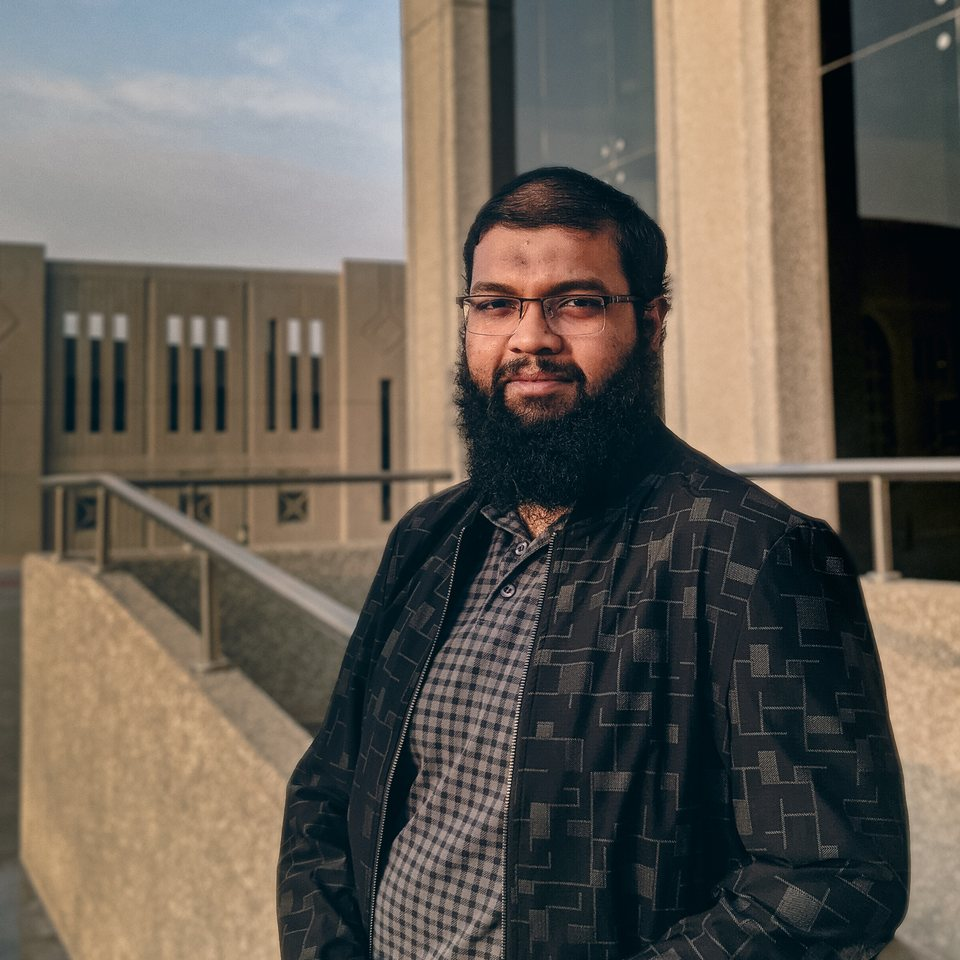

::: {.home}

::: {.home-head}

::: {.home-id}
<h1 class="home-name">Tasnemul Hasan Nehal</h1>

[Experimental Engineering · Multiphysics Research]{.home-role}
:::
:::

::: {.home-bio}

I am an experimental engineer at heart. I enjoy building things, testing them, understanding why they behave the way they do and using that understanding to make them better.

I am particularly fascinated by **coupled physical phenomena**—how interactions between different physical processes shape the behavior of complex systems. My research has taken me across magneto-mechanical, fluid–structure, fluid–particle and optical–molecular systems, reinforcing my interest in understanding systems through both **physics and experiment**.

I enjoy developing test rigs, integrating instrumentation, analyzing experimental data and relating them to the physics of the system. My academic research brought these elements together through a complete model-to-experiment workflow.

This curiosity has drawn me toward **reacting flows and combustion** where flow, chemistry, heat transfer, pressure waves and structural geometry interact under highly unsteady conditions. I want to understand these interactions through rigorous experiments, diagnostics and physics-based modeling.

:::

<nav class="home-links" aria-label="Site sections">
<a href="projects/index.html">Research</a>
<a href="publications/index.html">Publications</a>
<a href="teaching/index.html">Teaching</a>
</nav>

::: {.home-contact-links}
[Email](mailto:1th.nehal@gmail.com "Email")
[Google Scholar](https://scholar.google.com/citations?user=KqVMyEYAAAAJ "Google Scholar")
[ORCID](https://orcid.org/0000-0002-7143-6907 "ORCID")
[GitHub](https://github.com/tasnemul-hasan "GitHub")
[LinkedIn](https://linkedin.com/in/tasnemul-hasan "LinkedIn")
:::

:::
