::: {.project-meta}
::: {}
**Focus** Optical RNA biosensor
:::
::: {}
**Approach** Gold nanoparticles, sandwich hybridization
:::
::: {}
**Methods** UV–Vis, DLS, fibre-optic spectroscopy
:::
:::

::: {.proj-hero}
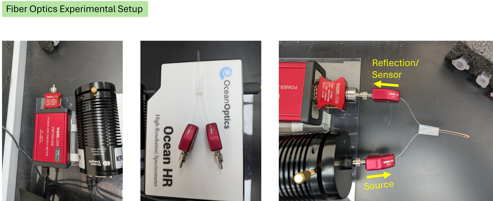
:::

## Overview

A sandwich biosensor detects a target through two separate recognition events. A capture molecule fixed to the sensor surface binds the target, and a second, detection molecule binds a different site on the same target. The signal appears only when the target sits between the two, which gives high specificity and low background. This project works towards an optical RNA biosensor of this kind, with gold nanoparticles carrying the detection RNA and an optical fibre probe carrying the capture RNA.

The work is organised in two stages. The first prepares and verifies the nanoparticles and the probe. The second forms the sandwich on the probe and reads it out optically.

::: {.steps}
::: {.step}
**1. Synthesize** Gold nanoparticles by citrate reduction
:::
::: {.step}
**2. Characterize** Size by DLS, plasmon peak by UV–Vis
:::
::: {.step}
**3. Conjugate** Thiolated detection RNA attached to the particles
:::
::: {.step}
**4. Functionalize** Fibre probe with capture RNA
:::
::: {.step}
**5. Hybridize and read** Target and conjugates on the probe, fibre-optic spectra
:::
:::

## Objectives

::: {.objectives}
- Synthesize gold nanoparticles by citrate reduction and verify their size and plasmon peak.
- Functionalize the fibre probe and conjugate thiolated detection RNA to the nanoparticles.
- Form the sandwich on the probe and read it out by fibre-optic spectroscopy.
:::

## Sensing principle

A sample such as blood contains many different molecules, labelled A to D below. Only the target (C, here a virus) is recognized. It binds to the capture molecule on the sensor surface, and a detection molecule then binds to another site on the same target, completing the sandwich. The signal is intensified only when the target is bound between the two recognition elements.

::: {.fig-grid}
::: {.fig .wide}
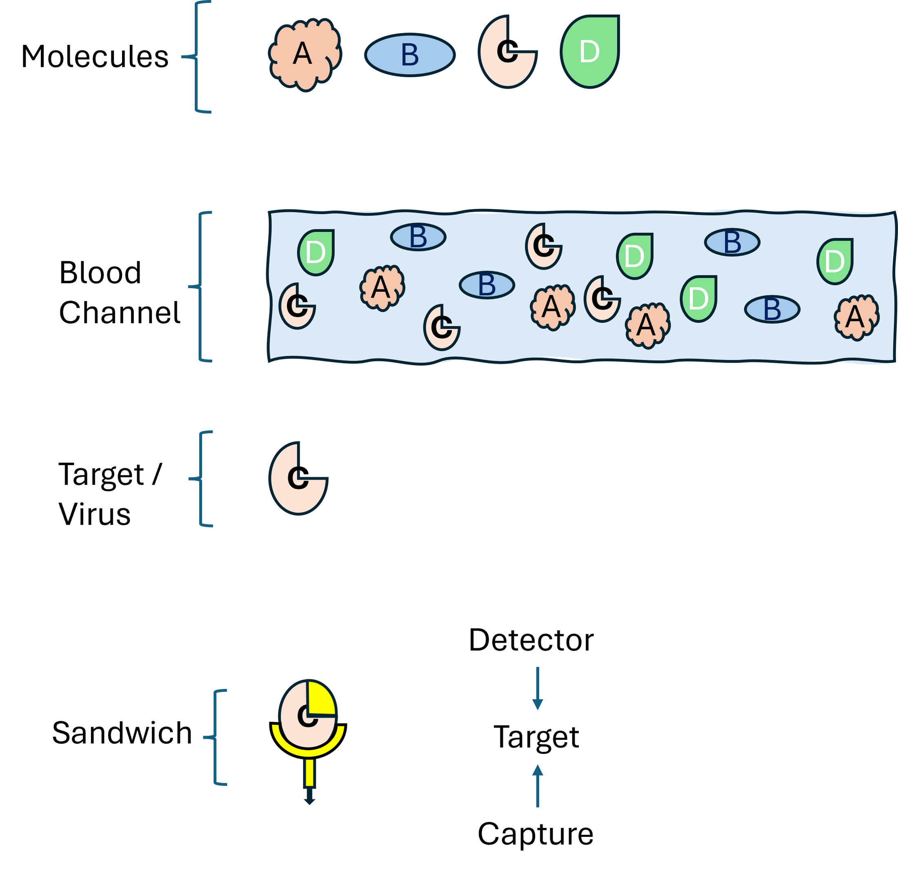
:::
:::

::: {.fig-grid}
::: {.fig .wide}
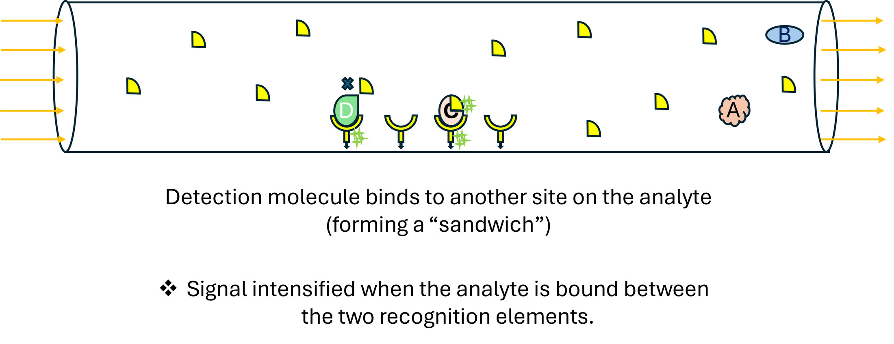
:::
:::

In practice the capture, target and detector solutions are combined into a final solution, which is characterized by its absorbance spectrum.

::: {.fig-grid}
::: {.fig .wide}
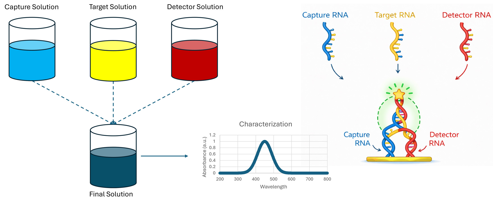
:::
:::

## Gold nanoparticle synthesis

Gold nanoparticles improve sensitivity, allow optical detection such as colorimetric sensing, bind biomolecules efficiently and are stable and biocompatible. They were made by the citrate method. Gold salt (HAuCl₄·3H₂O) is dissolved in distilled water and reduced by sodium citrate at about 100 °C. The citrate also keeps the particles from sticking together, and the amount added and the heating set their size.

| Solution | Concentration | Volume | Mass required | Mass used |
|---|---|---|---|---|
| Gold salt | 50 mM | 1 mL | 19.7 mg | 22.2 mg |
| Sodium citrate | 17 mM | 2 mL | 10.61 mg | 10.3 mg |

Distilled water (40 mL) is heated under magnetic stirring to about 100 °C. The gold solution is added, followed after a couple of minutes by the citrate solution. Heating continues until the solution turns pink.

::: {.fig-grid}
::: {.fig .narrow}
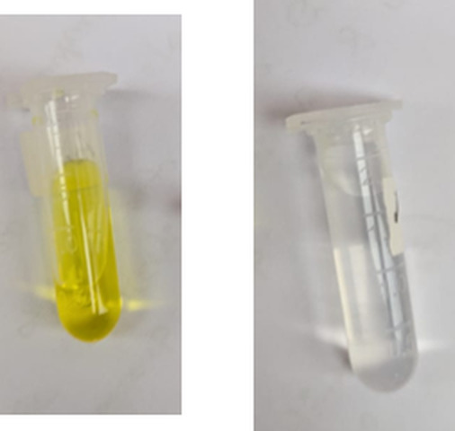
:::
:::

::: {.fig-grid}
::: {.fig .wide}
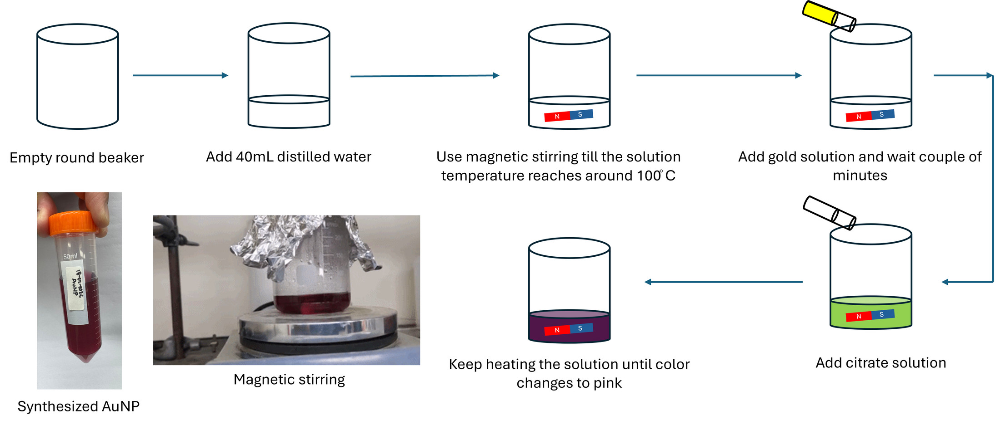
:::
:::

## Nanoparticle characterization

Dynamic light scattering (DLS) gives the particle size from the Brownian motion of the particles in a laser beam. UV–Vis spectroscopy gives the surface plasmon resonance, whose position indicates successful synthesis. Both were measured on a sample diluted 100 times.

The target size is 40–50 nm. Larger values indicate aggregates (150–300 nm) or outliers (above 300 nm). Of the 20 DLS measurements, a quarter fell in the target group at 47.7 ± 4.4 nm, a quarter in an aggregate group at 226.8 ± 55.6 nm, and half were outliers. The absorbance spectrum shows a distinct plasmon peak near 530 nm, which confirms that gold nanoparticles formed. The scattered points below 300 nm are measurement outliers.

::: {.fig-grid}
::: {.fig .wide}
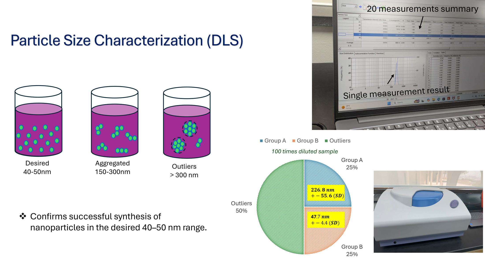{fig-alt="Particle size characterization by DLS"}
:::
:::

::: {.fig-grid}
::: {.fig .wide}
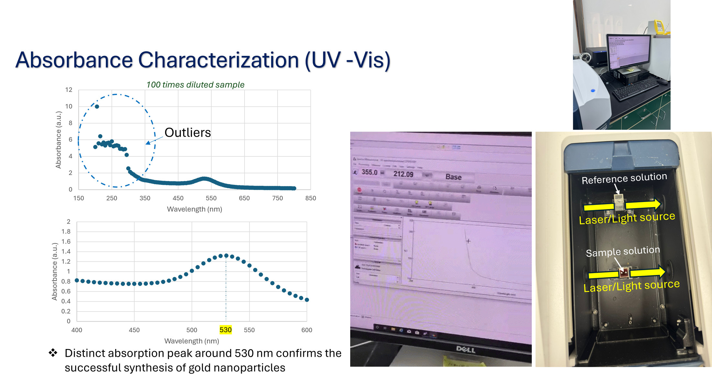{fig-alt="Absorbance characterization by UV–Vis"}
:::
:::

## Probe functionalization

The fibre probe needs a stable, reactive layer that keeps the capture probes attached, accessible and resistant to nonspecific adsorption. The surface is built in five steps.

::: {.steps}
::: {.step}
**1. Clean** Rinse in deionized water and dry with nitrogen
:::
::: {.step}
**2. HMDA** 10% in borate buffer for 2 h, which adds surface amine groups
:::
::: {.step}
**3. Heat** 45 °C for 10 min to stabilize the layer
:::
::: {.step}
**4. Glutaraldehyde** 2.5% for 20 min, a crosslinker with two aldehyde ends
:::
::: {.step}
**5. Wash** Removes unreacted glutaraldehyde
:::
:::

## Preparing the detection conjugates

### Reducing the thiolated RNA

Commercial thiolated oligonucleotides arrive in a protected, oxidized disulfide form, because free thiols (–SH) oxidize easily. TCEP, a strong and selective reducing agent, breaks the disulfide bond and releases the free thiol that binds to gold through an Au–S bond. The reduction needs at least 60 minutes. The dried capture oligonucleotide was dissolved in 482 µL to give 100 µM. A 90 µL portion (9 nmol) was reduced with 9 µL of 100 mM TCEP (900 nmol), a 100-fold molar excess that makes the reduction complete and fast.

### Cleaning the nanoparticles

Citrate competes with the oligonucleotides for the gold surface. The as-synthesized particles were therefore centrifuged (7500 rpm, 20 min), the supernatant was discarded and the pellet was resuspended in deionized water. This leaves more binding sites and lets salt be added in a controlled way later.

::: {.fig-grid}
::: {.fig .wide}
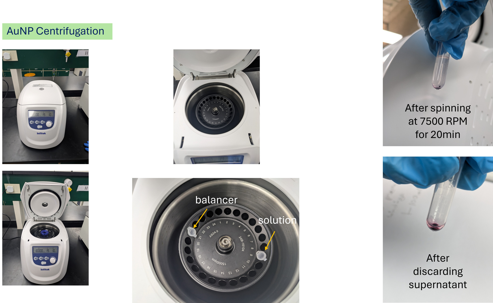{fig-alt="Centrifugation of the nanoparticles"}
:::
:::

### Stabilizing and conjugating

Without citrate the particles lose their electrostatic repulsion and can aggregate, so two stabilizers were added. Thiolated PEG (1.35 µL) binds to gold and extends into the solution, where the chains repel each other. Tween (15 µL) forms a loose protective layer that prevents aggregation while handling. The PEG amount matters. Too little leaves the particles aggregated, and too much blocks the sites the RNA needs.

DNA and gold nanoparticles are both negatively charged, so they repel each other. Salt screens the charge and lets the oligonucleotide pack densely on the gold surface. This is called salt aging. Thiolated oligonucleotide (8 µL) was added to the particles, and NaCl was added gradually, about 80 µL in 16 drops. The mixture was incubated for 1 h. It was then washed by centrifugation and resuspended in PBS (pH about 7.4) to remove free oligonucleotide, excess PEG, Tween and salt.

## Sandwich hybridization assay

The assay runs on the functionalized fibre probe in seven steps.

::: {.steps}
::: {.step}
**1. Immobilize** Probe oligonucleotide, 10 µM, 3 h
:::
::: {.step}
**2. Wash** PBS
:::
::: {.step}
**3. Glycine** 20 mM, 1 h, blocks reactive sites
:::
::: {.step}
**4. Wash** PBS
:::
::: {.step}
**5. BSA** 2 mg/mL, pH 4.6, 2 h, blocks nonspecific adsorption
:::
::: {.step}
**6. Wash** PBS
:::
::: {.step}
**7. Hybridize** 25 µL target with 25 µL conjugates, 10 min
:::
:::

## Optical readout

The fibre probe is read in a reflection configuration, with a halogen light source and the signal returning to a detector. A power meter was tried first. It measures only optical intensity, not molecular binding, and it is affected by alignment, scattering and environmental conditions. It also cannot tell specific from nonspecific binding. A high-resolution spectrometer replaced it, recording absorbance against wavelength so that the plasmon peak of the gold nanoparticles can be followed over time.

::: {.fig-grid}
::: {.fig .wide}
{fig-alt="Fibre-optic experimental setup"}
:::
:::

::: {.fig-grid}
::: {.fig .wide}
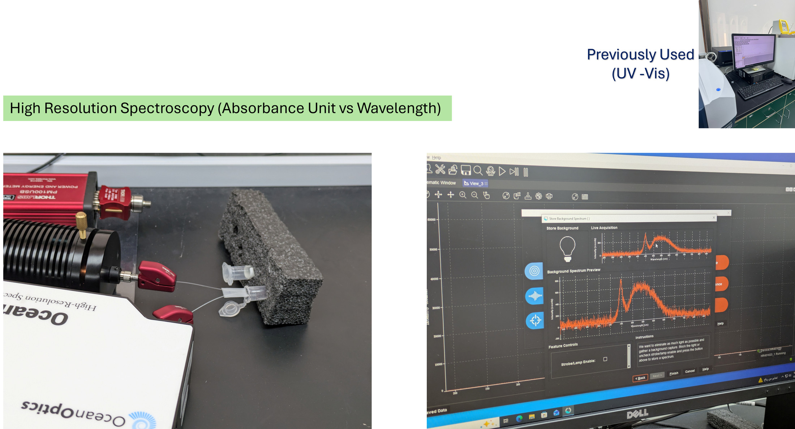{fig-alt="High-resolution spectroscopy setup"}
:::
:::

## Results: spectral measurements

Three probe conditions were exposed to the nanoparticles, and spectra were recorded at successive time points.

The bare fibre shows a plasmon peak at 540–550 nm that comes only from the intrinsic absorption and scattering of the nanoparticles, with no capture probe present. The fibre incubated in the capture probe shows a much stronger and sharper peak near 540 nm. Graphene oxide (GO) was also tried as a coating before the capture probe.

At 30 minutes the bare fibre acts as the reference, since the nanoparticles interact with it only weakly. The fibre with capture probe gives the strongest peak. The GO coating gives a lower, broader and smoother response. GO absorbs light over a wide band, and the thick coating adds scattering losses that damp the plasmonic interaction. A functionalized GO layer may spread the nanoparticles more evenly and reduce aggregation.

::: {.fig-grid}
::: {.fig .wide}
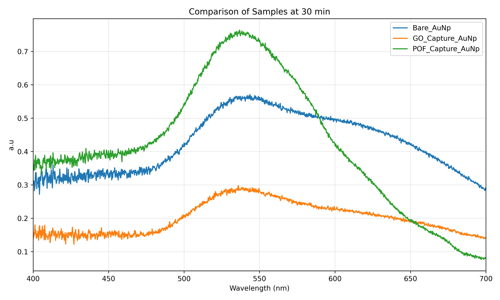
:::
:::

## Publications and resources

*No paper yet.*

::: {.proj-nav}
[← All Research Projects](../index.qmd){.btn .btn-outline-primary .btn-sm}

::: {.related}
**Related projects** [Real-Time Rotor Dynamics](../realtime/index.qmd) · [Vision-Based Tracking](../vehiclechase/index.qmd)
:::
:::
