::: {.project-meta}
::: {}
**Type** Conference paper
:::
::: {}
**Venue** IEEE SSD 2026, Catania, Italy
:::
::: {}
**Focus** Model-reference adaptive control
:::
::: {}
**Tools** COMSOL Multiphysics 6.2, MATLAB
:::
:::

## Overview

Autonomous underwater vehicles perform poorly when hydrodynamic effects such as drag change with water density and flow, and analytical models rarely capture those effects well. This work builds the reference model from a high-fidelity fluid–structure simulation instead of from assumptions. The simulation is used to generate rising and sinking data, a compact second-order reference model is identified from that data, and an adaptive feedback-linearising controller then tracks the reference while estimating the drag coefficient online.

## Objectives

::: {.objectives}
- Simulate buoyancy-driven rising and sinking of a body in water with a coupled fluid–structure model.
- Identify a second-order reference model from the simulated motion.
- Design an adaptive feedback-linearising depth controller that estimates the drag coefficient online.
- Assess tracking under different adaptive gains and external disturbances.
:::

## Control architecture

The vehicle's depth is controlled through the buoyant force. The depth error produces the control input, and a second-order reference model defines the ideal response. The error between the reference velocity and the measured velocity, obtained by differentiating the depth, drives an adaptation law that updates the drag coefficient used by the controller.

::: {.fig-grid}
::: {.fig .wide}
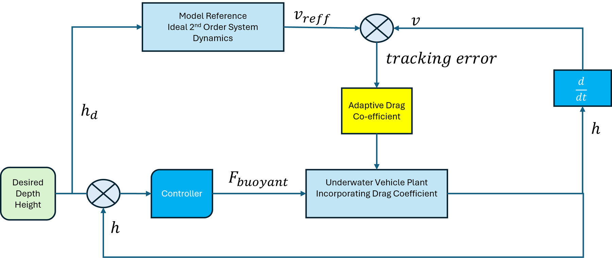
:::
:::

## Fluid–structure simulation

The buoyancy-driven heave motion of a body in water was simulated in COMSOL Multiphysics 6.2 as a two-dimensional air–water–acrylic domain. The model couples laminar flow, solid mechanics, a phase-field method that tracks the air–water interface, and an ALE moving mesh that follows the body. The body is treated as a linearly elastic solid constrained to rigid motion. Displacement, velocity, acceleration and hydrodynamic force were recorded from a time-dependent study with a 0.01 s step.

The domain is 0.10 m wide, with water up to 0.10 m, 0.05 m of air above it, and a small square body, about 2.5 cm on a side, near the bottom.

::: {.fig-grid .two}
::: {.fig}
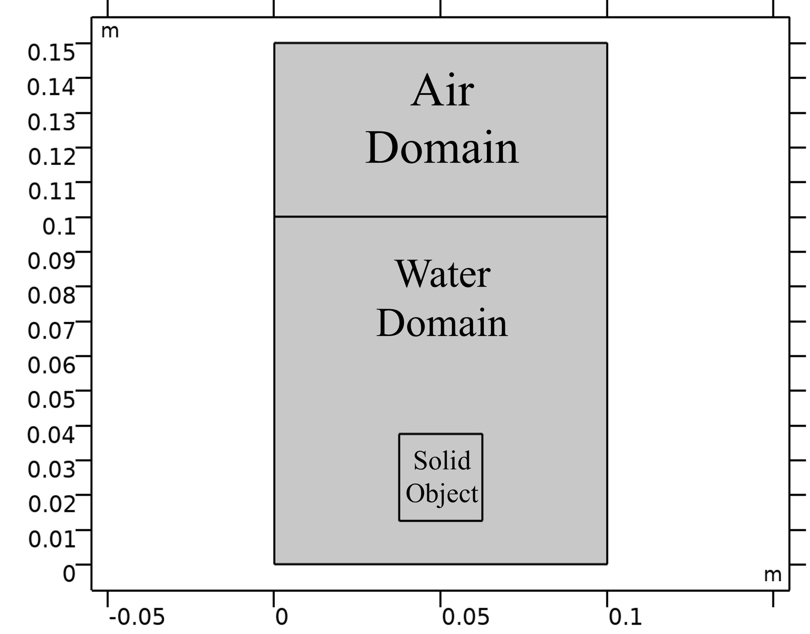
:::
::: {.fig}
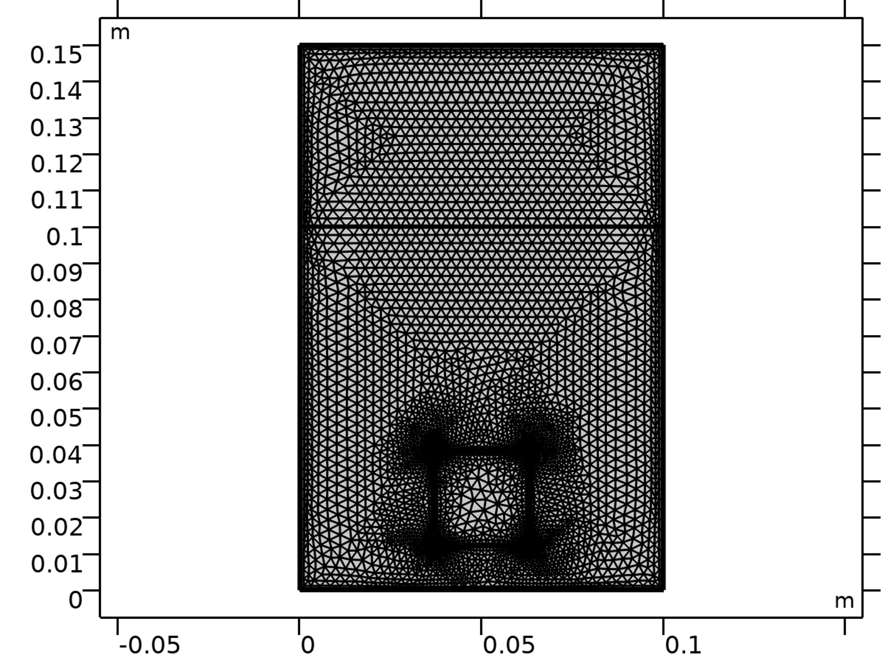
:::
:::

The animations show unedited simulation output from t = 0 s: the moving mesh and the velocity field.

::: {.fig-grid .two}
::: {.fig}
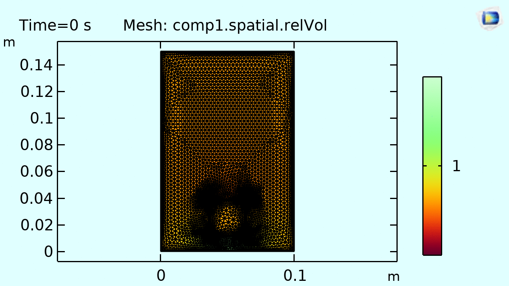{loading="lazy"}
:::
::: {.fig}
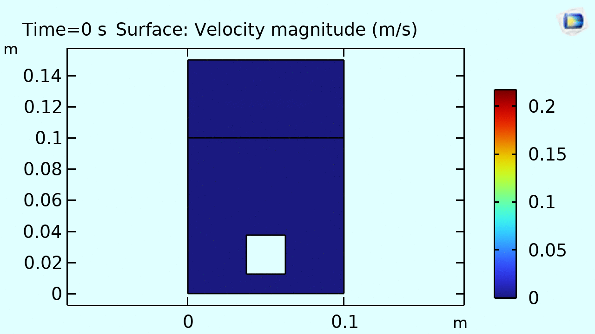{loading="lazy"}
:::
:::

### Rising and sinking cases

Five body densities were simulated. Bodies lighter than water (900, 945 and 990 kg/m³) rise and denser bodies (1055 and 1100 kg/m³) sink. The panels show the phase distribution, with air in red, water in blue and the air–water interface as the black line.

::: {.fig-grid}
::: {.fig .wide}
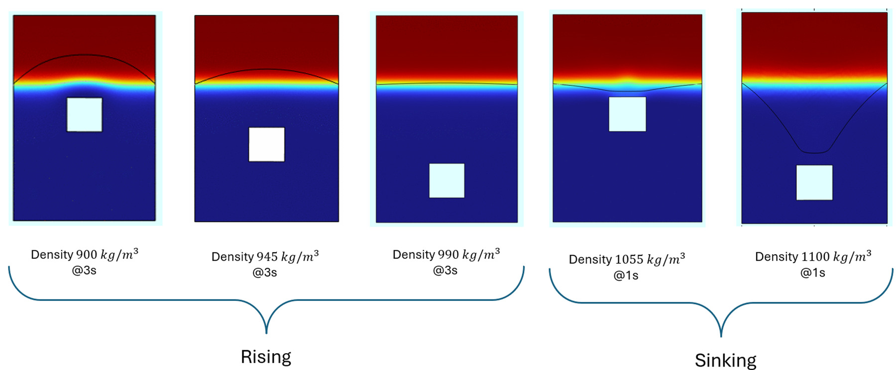
:::
:::

The further the density is from that of water, the further the body travels in the same time and the more the interface is deformed. A light body pushes the surface up into a dome as it rises, while a heavy body pulls the surface down into a trough behind it.

The animations show unedited simulation output from t = 0 s for the rising, sinking and disturbance cases, with air in red and water in blue.

::: {.fig-grid .two}
::: {.fig}
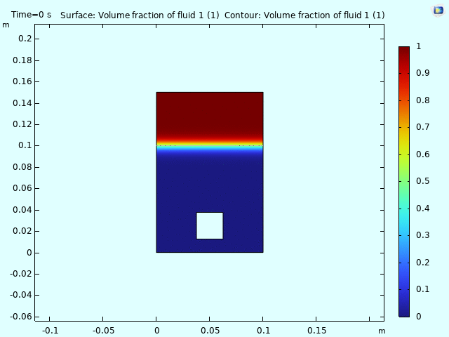{loading="lazy"}
:::
::: {.fig}
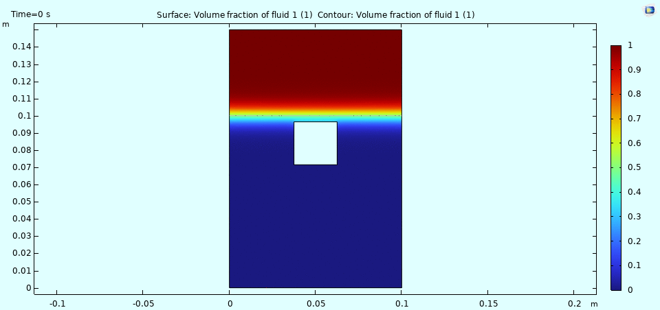{loading="lazy"}
:::
:::

::: {.fig-grid}
::: {.fig .wide}
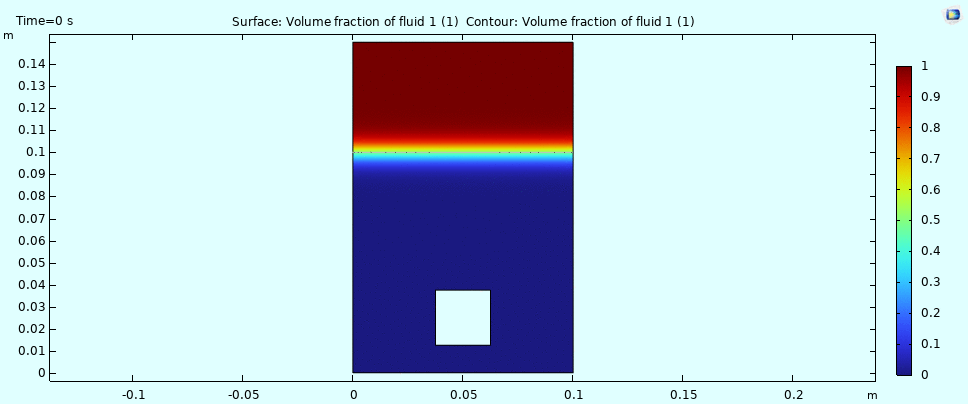{loading="lazy"}
:::
:::

### Motion profiles

Velocity against displacement shows an asymmetric heave response governed by fluid resistance. In the rising cases the lightest body (900 kg/m³) reaches about 0.13 m/s, the 945 kg/m³ body about 0.09 m/s, and the near-neutral 990 kg/m³ body stays near 0.02 m/s. The sinking bodies settle at about 0.10 m/s (1055 kg/m³) and 0.14 m/s (1100 kg/m³).

::: {.fig-grid .two}
::: {.fig}
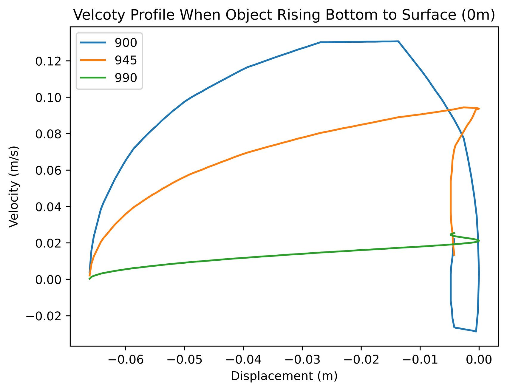
:::
::: {.fig}
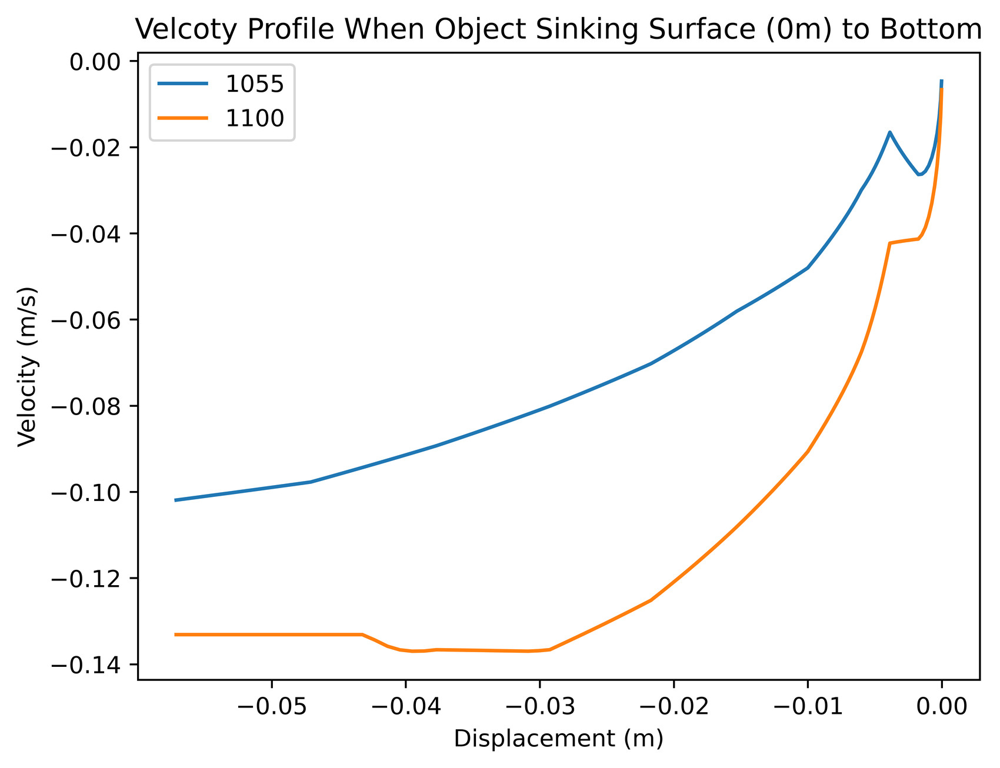
:::
:::

## Reference model identification

The recorded motion is approximated by a second-order system,

$$\ddot{x} + 2\zeta\omega_n\dot{x} + \omega_n^2 x = 0,$$

and its parameters are identified from the simulated displacement, velocity and acceleration with recursive least squares and a forgetting factor. The regression $\ddot{x} = a_1\dot{x} + a_2 x + a_3$ maps to the natural frequency and damping ratio through $\omega_n = \sqrt{-a_2}$ and $\zeta = -a_1/(2\omega_n)$.

The identified natural frequencies and damping ratios for the five densities were averaged to define the nominal reference model, with $\omega_n = 2.53$ rad/s and $\zeta = 0.39$.

<table class="data-table">
<thead><tr><th>Density (kg/m³)</th><th>Motion in simulation</th><th>Natural frequency ωn (rad/s)</th><th>Damping ratio ζ</th></tr></thead>
<tbody>
<tr><td>900</td><td>Rising</td><td>3.506</td><td>0.301</td></tr>
<tr><td>945</td><td>Rising</td><td>3.468</td><td>0.615</td></tr>
<tr><td>990</td><td>Rising</td><td>0.652</td><td>0.281</td></tr>
<tr><td>1055</td><td>Sinking</td><td>1.540</td><td>0.245</td></tr>
<tr><td>1100</td><td>Sinking</td><td>3.473</td><td>0.533</td></tr>
<tr><td><b>Average</b></td><td></td><td><b>2.528</b></td><td><b>0.395</b></td></tr>
</tbody></table>

## Adaptive controller

The vertical dynamics of the vehicle balance buoyancy, drag and weight,

$$m\ddot{z} = u - \tfrac{1}{2}\rho A C_d\,|\dot{z}|\dot{z} - mg,$$

where $u$ is the buoyant force and $C_d$ the unknown drag coefficient. Feedback linearisation cancels the nonlinear terms using an estimate $\hat{C}_d$, so that the vehicle follows the reference model. The estimate is updated by the adaptation law

$$\dot{\hat{C}}_d = -\gamma\,\phi\,v|v|\,e_v,$$

with $e_v$ the velocity error against the reference model and $\gamma$ the adaptive gain. A Lyapunov function built from the velocity error and the drag-estimation error has a non-positive derivative under this law, which guarantees stability and a bounded tracking error. The feedback gains follow from the reference model as $k_1 = 2\zeta\omega_n = 1.995$ and $k_2 = \omega_n^2 = 6.387$. In the simulations the control input is limited to 10 N and the drag coefficient to 5.

## Results: adaptive control

::: {.evidence-note}
**Data source** Simulation results.
:::

### Effect of the adaptive gain

A higher adaptive gain γ speeds up tracking and drag adaptation, but it brings overshoot and larger control effort. A lower γ gives smoother but slower responses.

::: {.fig-grid}
::: {.fig .narrow}
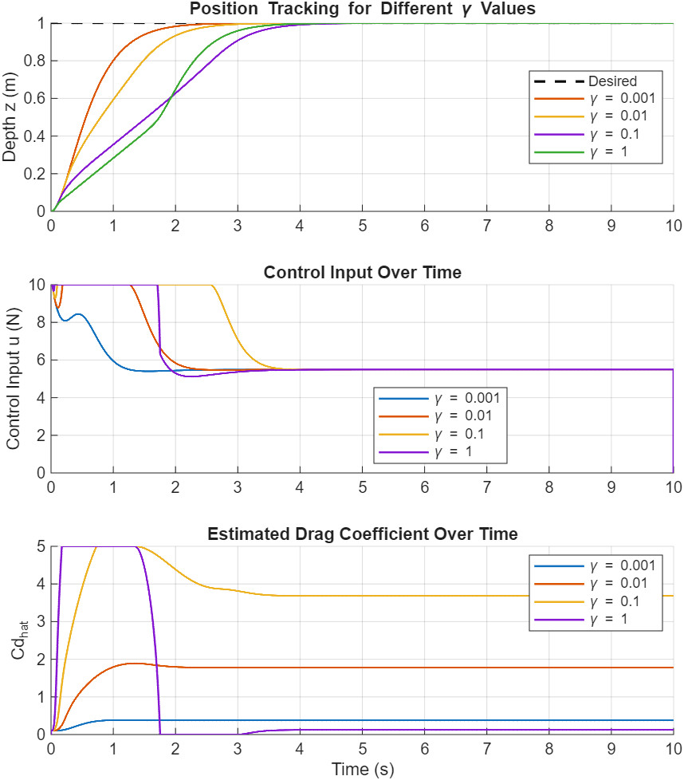
:::
:::

### Robustness to external disturbance

A sinusoidal force was added to the plant, once with fixed frequency and varying amplitude, and once with fixed amplitude and varying frequency. Larger amplitude mainly raises the control effort. Higher frequency causes stronger oscillations and slight loss of tracking accuracy, so the controller is more sensitive to frequency than to amplitude.

::: {.fig-grid}
::: {.fig .wide}
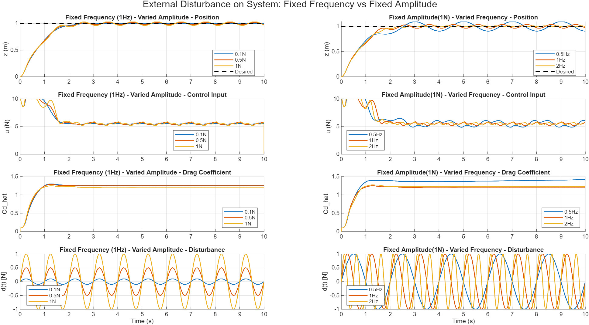
:::
:::

With a 1 N, 2 Hz disturbance the plant still follows the stepped reference, and the drag estimate stays stable.

::: {.fig-grid}
::: {.fig .wide}
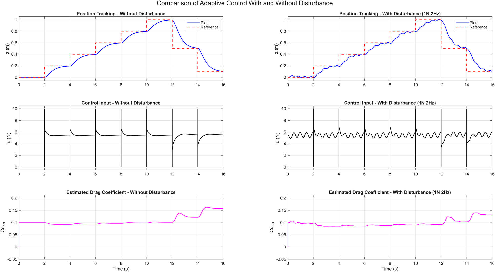
:::
:::

## Publications and resources

::: {.paper-card}
**COMSOL-Based Model Reference and Adaptive Depth Control of Underwater Vehicle** Nehal, Nasution & El-Ferik (2026), IEEE SSD · [Link](https://doi.org/10.1109/SSD69655.2026.11559081)
:::

::: {.proj-nav}
[← All Research Projects](../index.qmd){.btn .btn-outline-primary .btn-sm}

::: {.related}
**Related projects** [Magnetic Levitation System](../maglev/index.qmd) · [Smart Materials (MR Fluid)](../mr/index.qmd) · [Vision-Based Tracking](../vehiclechase/index.qmd) · [Soft Pneumatic Gripper](../soft-robotics/index.qmd)
:::
:::
