::: {.project-meta}
::: {}
**Team**<br>Circuit Maesters, Ahsanullah University (Bangladesh)
:::
::: {}
**Role**<br>Co-founder, Deputy Team Leader, Electronics Systems Leader
:::
::: {}
**Vehicle**<br>Level-4 autonomous electric race car
:::
::: {}
**Target**<br>Formula Student AI, Silverstone (UK)
:::
::: {}
**Battery pack**<br>84S6P (504 cells)
:::
:::

## Overview

Circuit Maesters is the first Formula Student Artificial Intelligence (FS-AI) team in Bangladesh. Nehal co-founded the team to build a Level-4 autonomous electric race car, grow local expertise in electric mobility and autonomous systems, and prepare students for the Formula Student AI competition at Silverstone, UK.

As Deputy Team Leader and Electronics Systems Leader, Nehal carried both the technical work and the coordination. The team brought together students from electrical, mechanical and computer engineering, and turned a student-led initiative into a structured engineering organization built around research, innovation and hands-on system development.

## Objectives

::: {.objectives}
Team objectives:

- Build a Level-4 autonomous electric race car.
- Grow local expertise in electric mobility and autonomous systems.
- Prepare students for the Formula Student AI competition at Silverstone, UK.
:::

## Individual responsibilities

::: {.steps}
::: {.step}
**Electronics architecture**<br>Vehicle-level electronics, sensor integration, subsystem communication
:::
::: {.step}
**Power systems**<br>Battery pack, monitoring, protection and testing
:::
::: {.step}
**Team leadership**<br>Planning, task allocation and technical reviews across teams
:::
:::

## Vehicle electronics architecture

Nehal led the design and integration of the vehicle's electronic architecture. That began with studying modern automotive electronics and adapting them to the needs of a Formula Student electric vehicle. Reverse engineering and system-level analysis of commercial automotive electronic systems helped define the communication structure and subsystem interactions the autonomous platform needs.

The result is a distributed network built on CAN bus communication. Nehal helped define the interfaces among the accumulator system, inverter, safety systems, supervisory controllers, cockpit electronics, sensor modules and external interfaces. The work produced system-level communication diagrams, subsystem specifications and an integration strategy for reliable information exchange across the vehicle.

::: {.fig-grid}
::: {.fig .narrow}
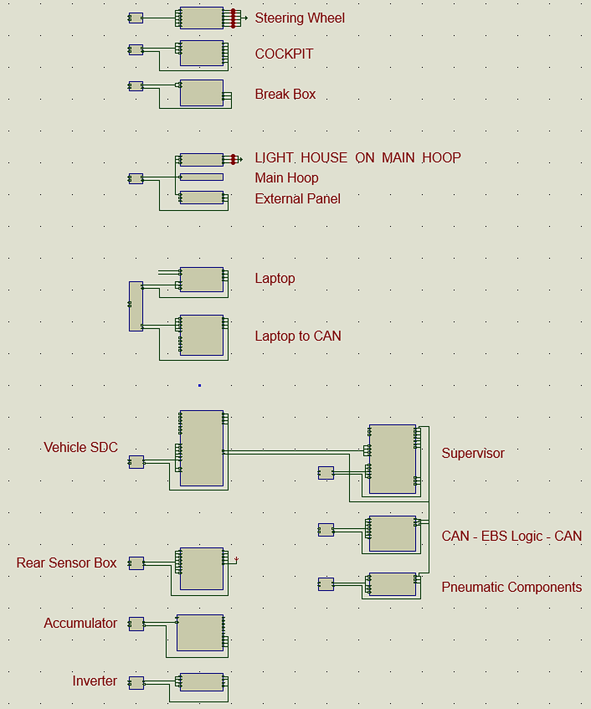
:::
:::

## Battery pack and monitoring

In the power systems division, Nehal contributed to developing and testing the electric vehicle battery pack and its monitoring infrastructure. The work covered battery management functions, instrumentation, safety monitoring and electrical protection, along with prototype development, laboratory testing and validation so that the high-voltage subsystems operate safely.

### Building the pack

The pack is 84S6P in total: 84 cells in series, with 6 cells in parallel at each step, for 504 cells. The cells are Molicel 21700 types held in plastic cell holders and joined with nickel strips.

::: {.fig-grid}
::: {.fig}
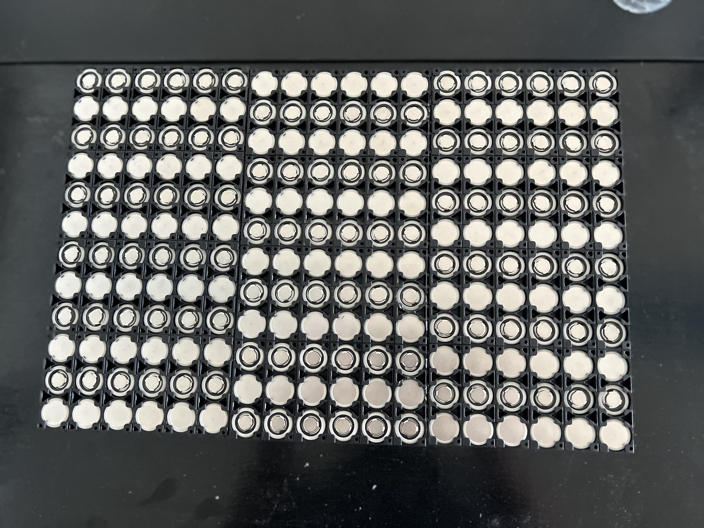
:::
::: {.fig}
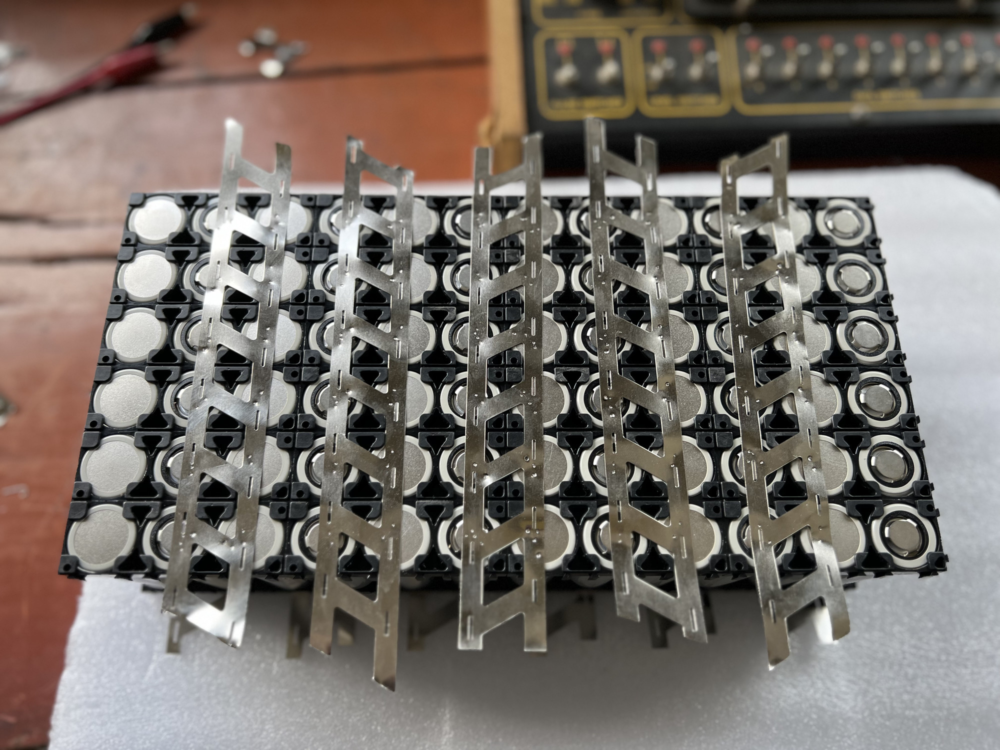
:::
::: {.fig}
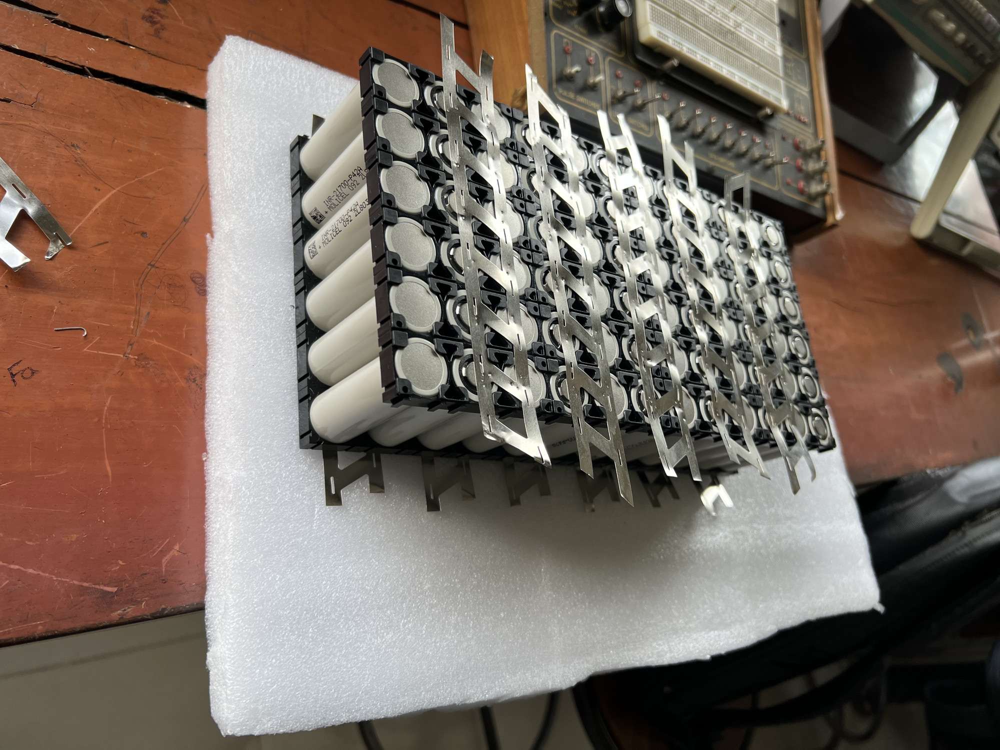
:::
::: {.fig .wide}
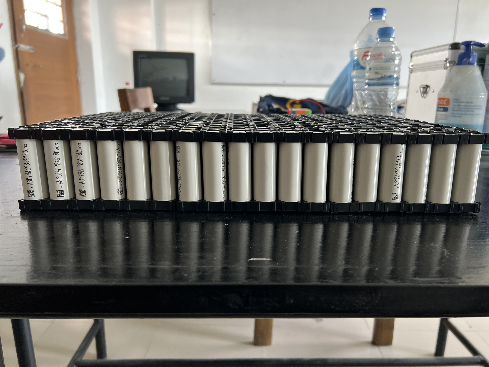
:::
:::

::: {.fig-grid}
::: {.fig}
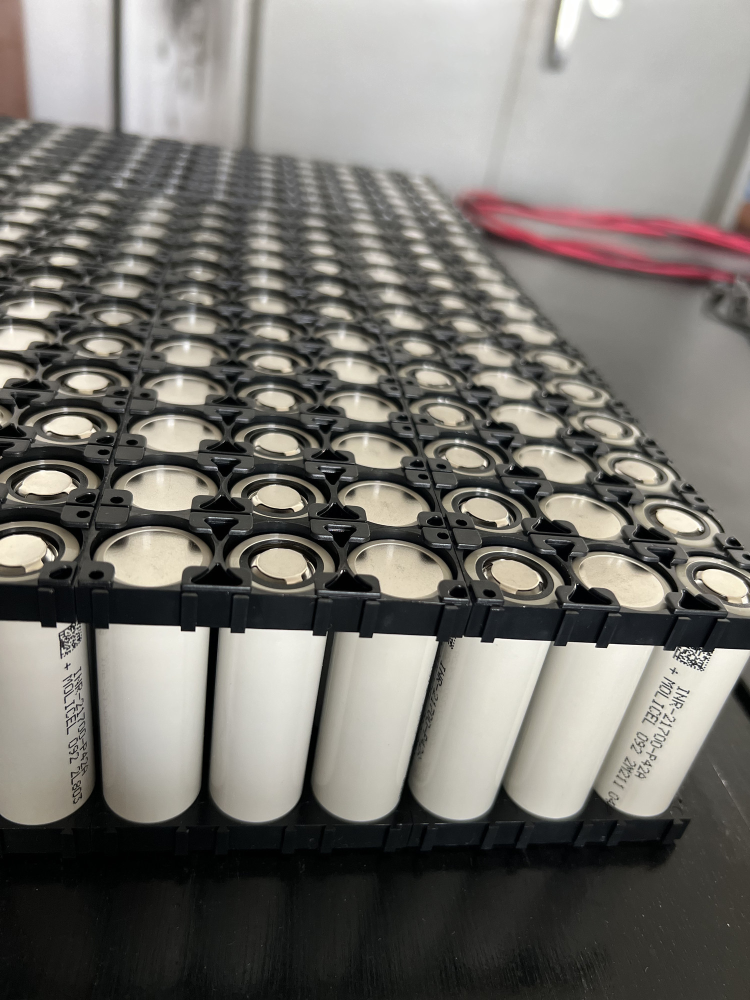
:::
::: {.fig}
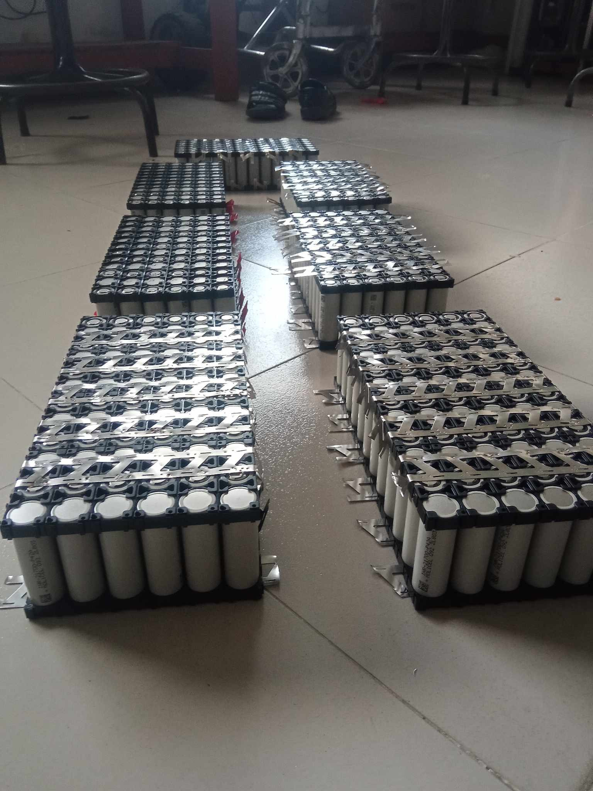
:::
::: {.fig}
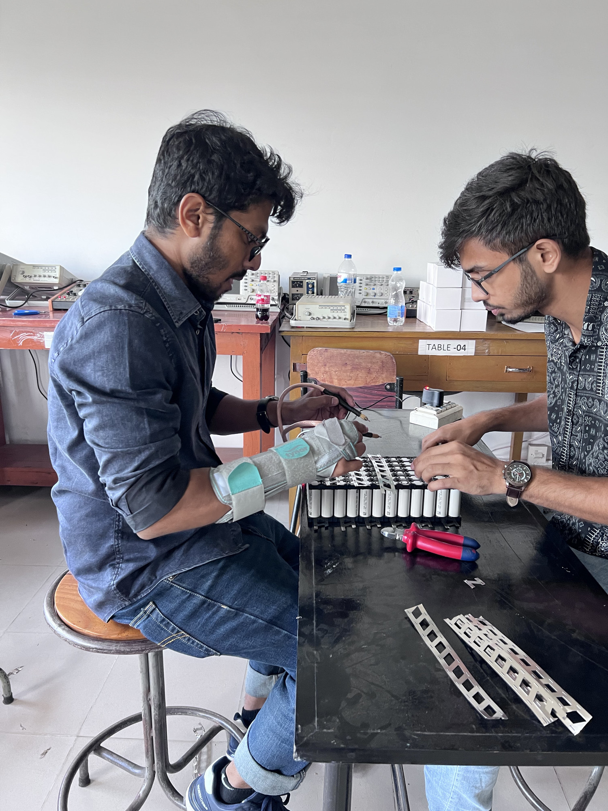
:::
::: {.fig .narrow}
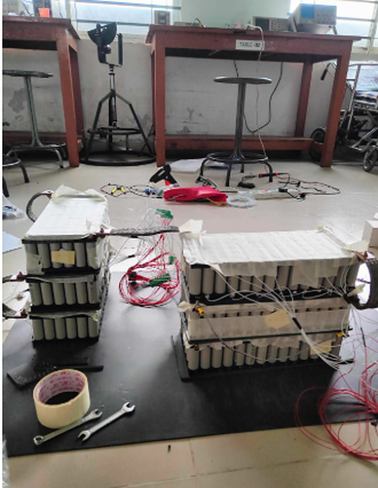
:::
:::

### Testing and validation

::: {.fig-grid}
::: {.fig}
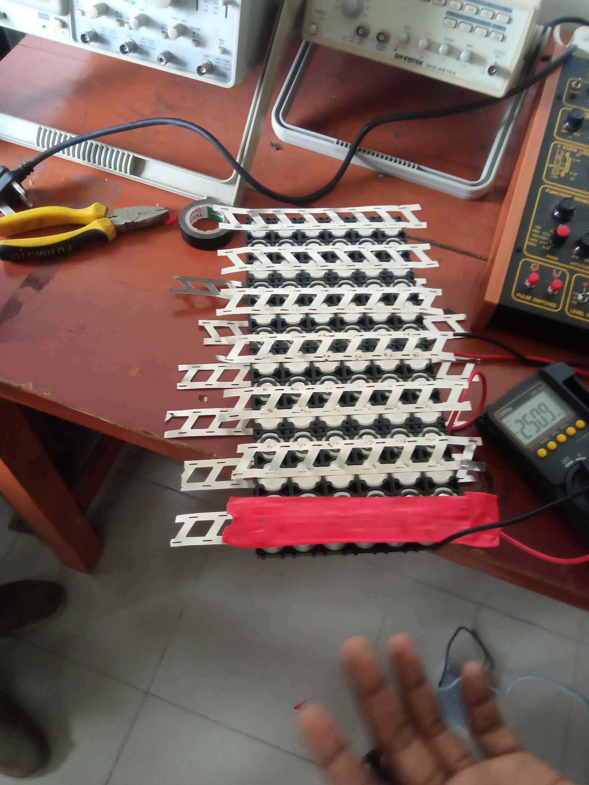
:::
::: {.fig .wide}
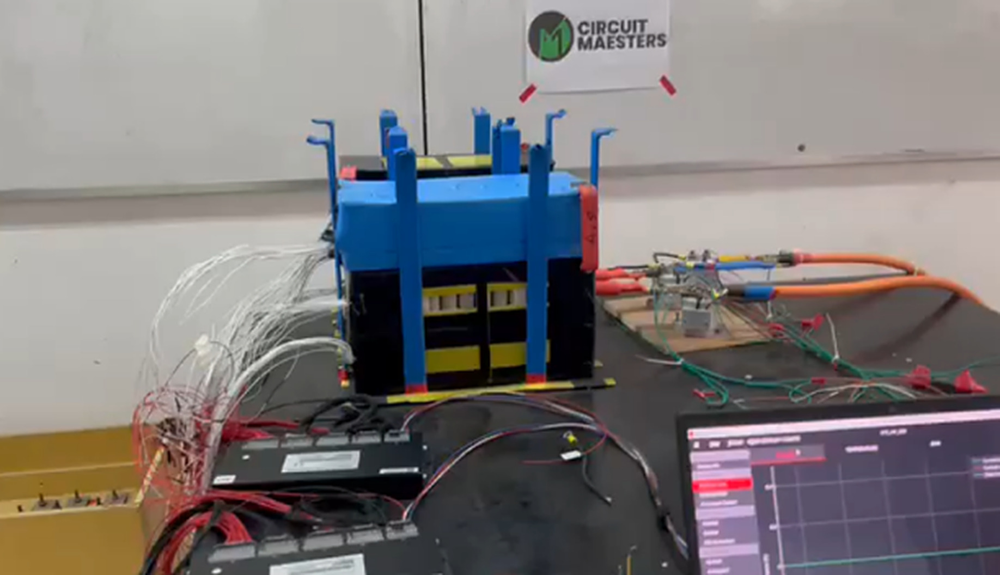
:::
:::

### Monitoring and charging hardware

The accumulator management system is split into a master unit (MU) and two sampling units (SU1 and SU2), shown here with an air-cooled charger.

::: {.fig-grid}
::: {.fig .narrow}
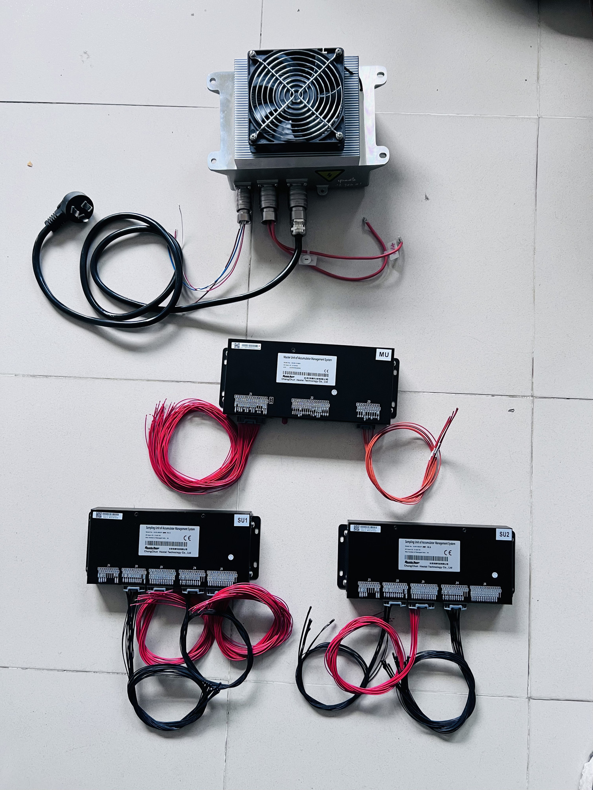
:::
:::

### Build and battery-management videos

```{=html}
<div class="vid-grid">
<figure class="vid"><div class="vid-frame"><iframe src="https://www.youtube-nocookie.com/embed/jKSQhvfhkUk" title="Custom battery pack design and BMS wiring" loading="lazy" allow="accelerometer; clipboard-write; encrypted-media; gyroscope; picture-in-picture; web-share" allowfullscreen></iframe></div><figcaption>Custom battery pack design and BMS wiring · <a href="https://www.youtube.com/watch?v=jKSQhvfhkUk">Watch on YouTube</a></figcaption></figure>
<figure class="vid"><div class="vid-frame"><iframe src="https://www.youtube-nocookie.com/embed/rT2fTR0L5yw" title="Custom battery pack assembly" loading="lazy" allow="accelerometer; clipboard-write; encrypted-media; gyroscope; picture-in-picture; web-share" allowfullscreen></iframe></div><figcaption>Custom battery pack assembly · <a href="https://www.youtube.com/watch?v=rT2fTR0L5yw">Watch on YouTube</a></figcaption></figure>
</div>
```

```{=html}
<div class="vid-grid">
<figure class="vid short"><div class="vid-frame"><iframe src="https://www.youtube-nocookie.com/embed/j0iJjgzdXDs" title="Spot welding the custom battery pack" loading="lazy" allow="accelerometer; clipboard-write; encrypted-media; gyroscope; picture-in-picture; web-share" allowfullscreen></iframe></div><figcaption>Spot welding the custom battery pack · <a href="https://www.youtube.com/watch?v=j0iJjgzdXDs">Watch on YouTube</a></figcaption></figure>
<figure class="vid short"><div class="vid-frame"><iframe src="https://www.youtube-nocookie.com/embed/PrPZFjKRQN0" title="Battery management system demo" loading="lazy" allow="accelerometer; clipboard-write; encrypted-media; gyroscope; picture-in-picture; web-share" allowfullscreen></iframe></div><figcaption>Battery management system demo · <a href="https://www.youtube.com/watch?v=PrPZFjKRQN0">Watch on YouTube</a></figcaption></figure>
</div>
```

## High-voltage system and motor control

```{=html}
<div class="vid-grid">
<figure class="vid"><div class="vid-frame"><iframe src="https://www.youtube-nocookie.com/embed/14rsxTsdEsM" title="Complete high-voltage setup" loading="lazy" allow="accelerometer; clipboard-write; encrypted-media; gyroscope; picture-in-picture; web-share" allowfullscreen></iframe></div><figcaption>Complete high-voltage setup · <a href="https://www.youtube.com/watch?v=14rsxTsdEsM">Watch on YouTube</a></figcaption></figure>
<figure class="vid"><div class="vid-frame"><iframe src="https://www.youtube-nocookie.com/embed/b5_1lrCsAuY" title="High-voltage boot-up" loading="lazy" allow="accelerometer; clipboard-write; encrypted-media; gyroscope; picture-in-picture; web-share" allowfullscreen></iframe></div><figcaption>High-voltage boot-up · <a href="https://www.youtube.com/watch?v=b5_1lrCsAuY">Watch on YouTube</a></figcaption></figure>
</div>
```

```{=html}
<div class="vid-grid">
<figure class="vid short"><div class="vid-frame"><iframe src="https://www.youtube-nocookie.com/embed/2HKBQqDUEpE" title="Emrax 208 MV motor control demo" loading="lazy" allow="accelerometer; clipboard-write; encrypted-media; gyroscope; picture-in-picture; web-share" allowfullscreen></iframe></div><figcaption>Emrax 208 MV motor control demo · <a href="https://www.youtube.com/watch?v=2HKBQqDUEpE">Watch on YouTube</a></figcaption></figure>
</div>
```

## Chassis fabrication

The car's tubular space-frame chassis was built in a local workshop, with the team checking the welded frame against the CAD model as it came together. The chassis was coordinated with the electronics and battery layout. The plate-cut parts for the frame are shown in the laser-cutting video below.

::: {.fig-grid .two}
::: {.fig}
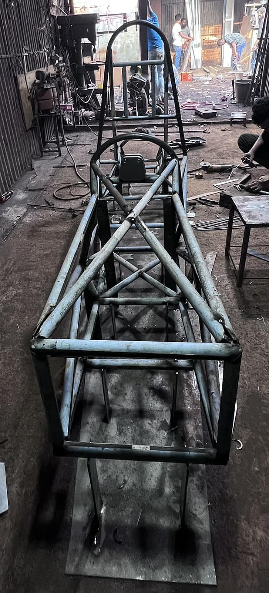
:::
::: {.fig}
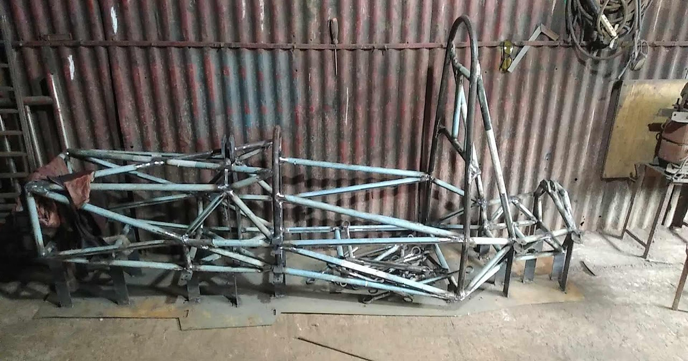
:::
:::

::: {.fig-grid .two}
::: {.fig}
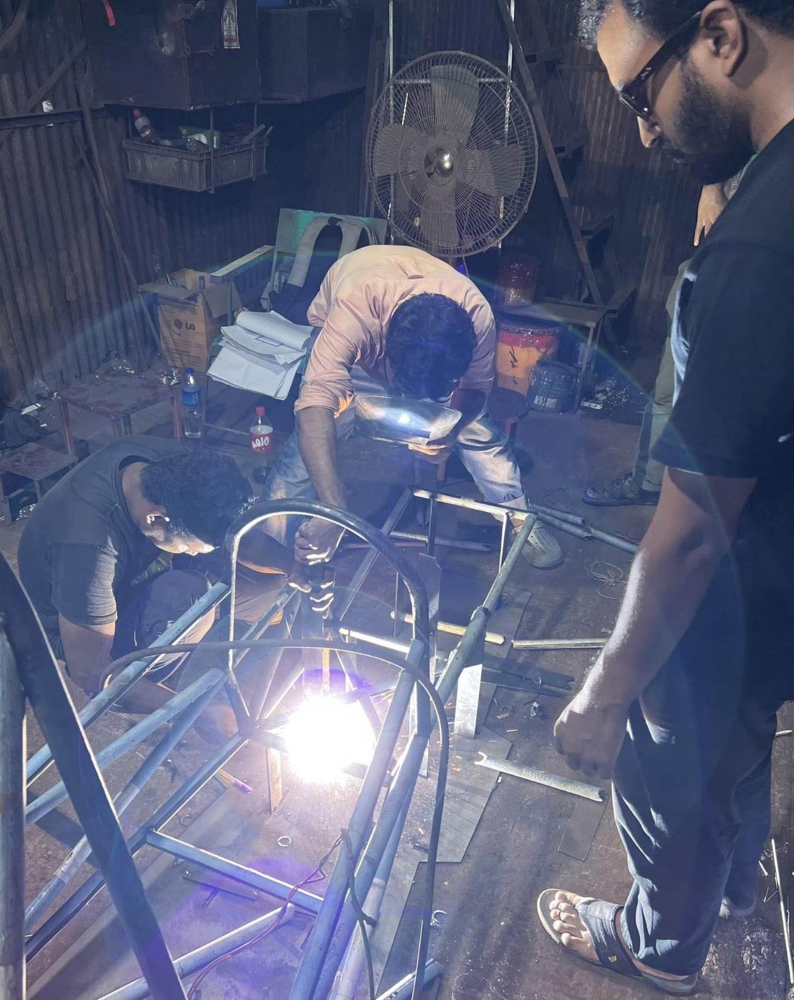
:::
::: {.fig}
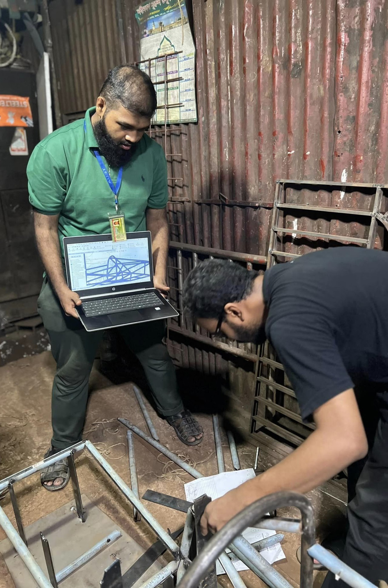
:::
:::

::: {.fig-grid}
::: {.fig .wide}
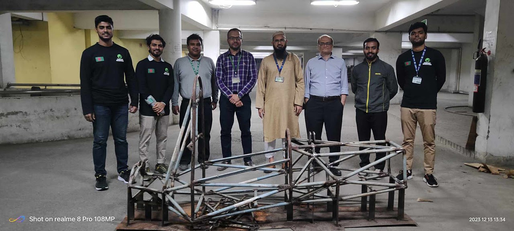
:::
:::

```{=html}
<div class="vid-grid">
<figure class="vid short"><div class="vid-frame"><iframe src="https://www.youtube-nocookie.com/embed/ZvCM8hh_MqI" title="Chassis laser cutting" loading="lazy" allow="accelerometer; clipboard-write; encrypted-media; gyroscope; picture-in-picture; web-share" allowfullscreen></iframe></div><figcaption>Chassis laser cutting · <a href="https://www.youtube.com/watch?v=ZvCM8hh_MqI">Watch on YouTube</a></figcaption></figure>
</div>
```

## Progress presentation at AUST

On 21 December 2023 the team presented its progress on building Bangladesh's first driverless electric vehicle to the Vice-Chancellor of Ahsanullah University of Science and Technology (AUST), the head of the Electrical and Electronic Engineering department, and the team's faculty advisors. The session showed the accumulator, motor controller, mounts and other hardware built so far.

::: {.fig-grid .two}
::: {.fig}
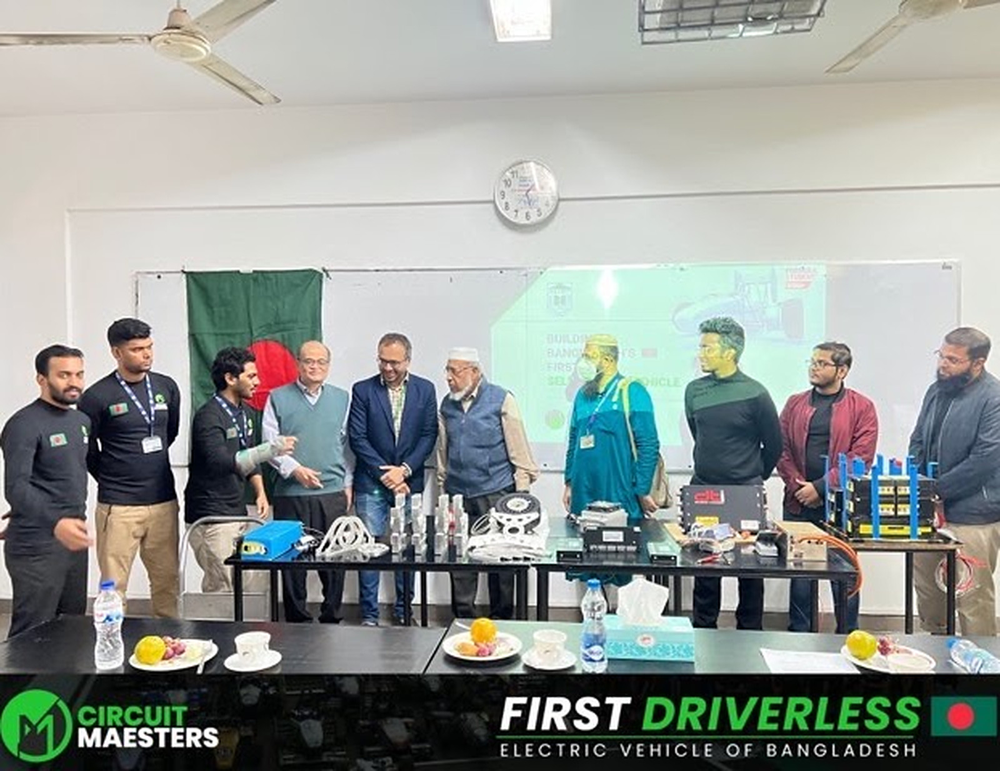
:::
::: {.fig}
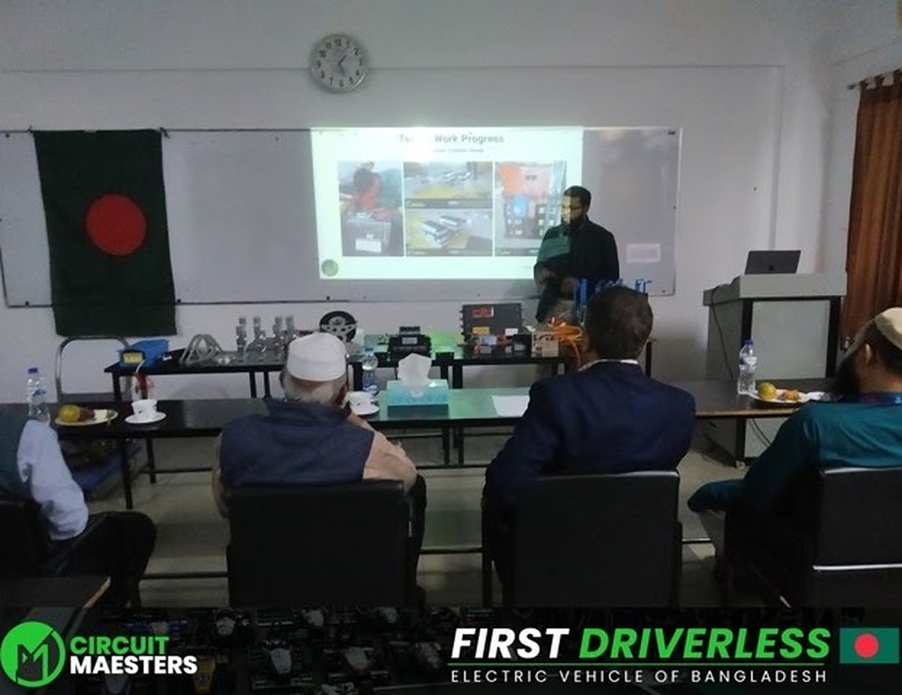
:::
:::

::: {.fig-grid .two}
::: {.fig}
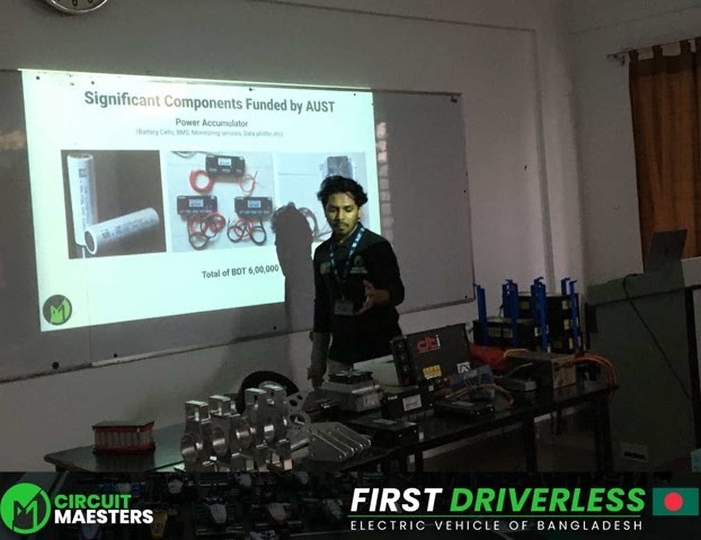
:::
:::

::: {.fig-grid}
::: {.fig .wide}
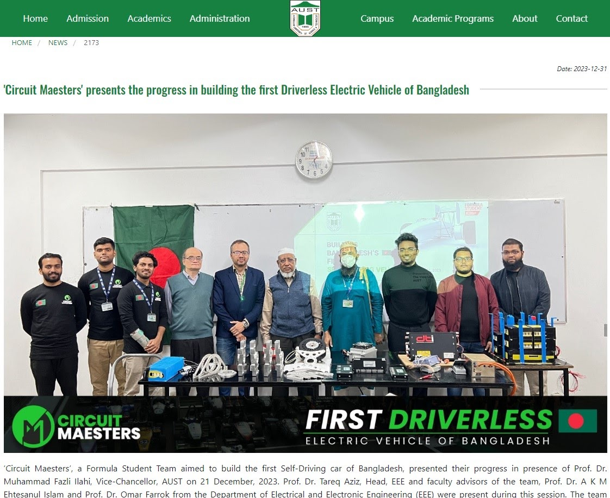
:::
:::

## Publications and resources

[ Formula Student AI certificate](../../files/fsai/formula-student-ai-certificate.pdf){.btn .btn-outline-primary .btn-sm}

::: {.proj-nav}
[← All Research Projects](../index.qmd){.btn .btn-outline-primary .btn-sm}

::: {.related}
**Related projects** [Data-Driven Adaptive Depth Control of an Underwater Vehicle](../datadriven/index.qmd) · [Vision-Based Tracking](../vehiclechase/index.qmd)
:::
:::
