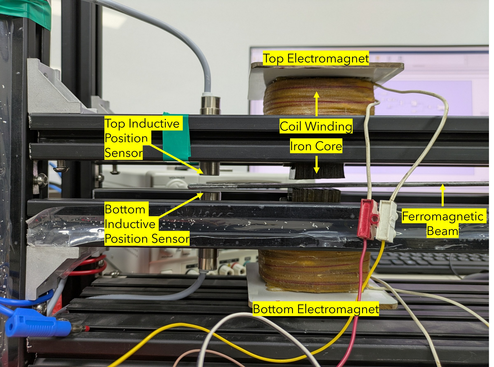
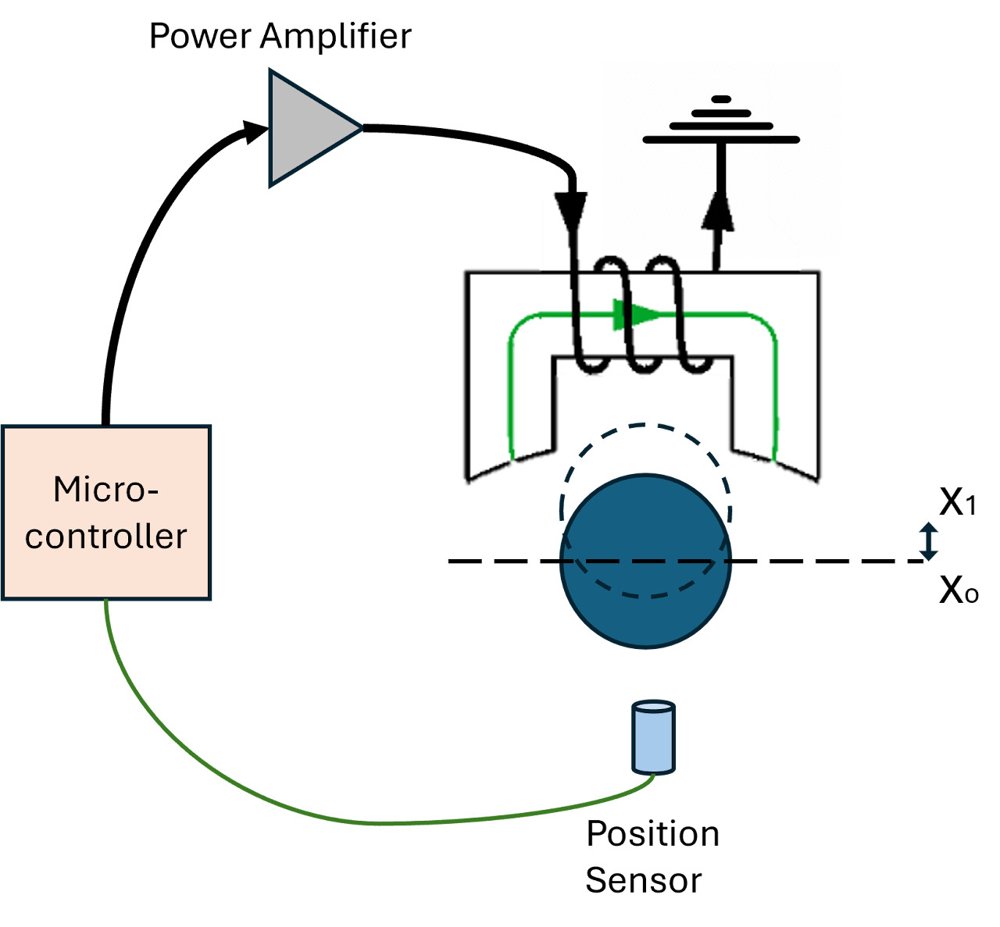
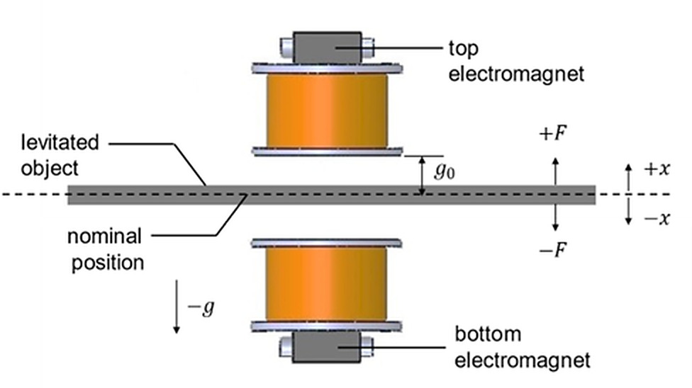
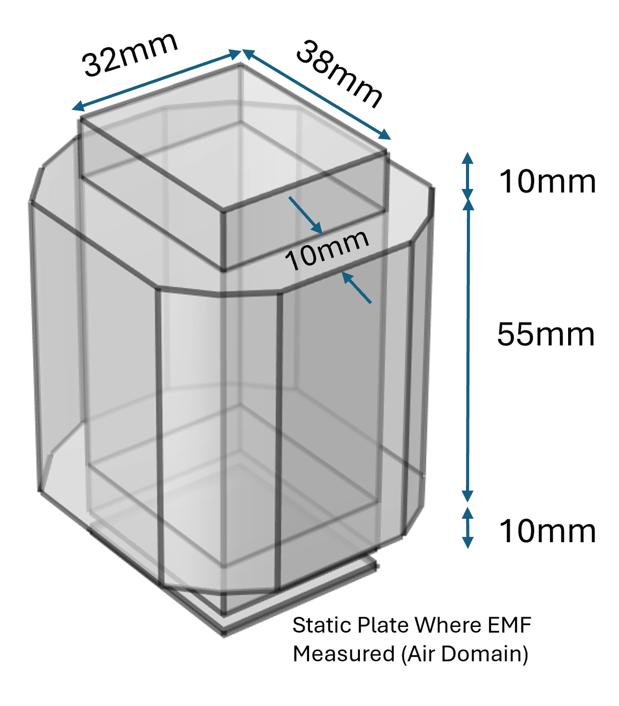
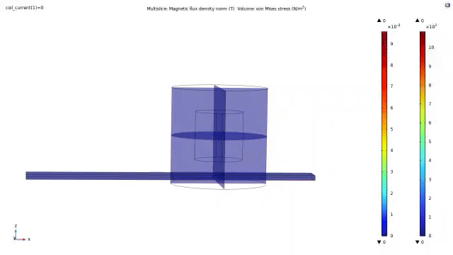
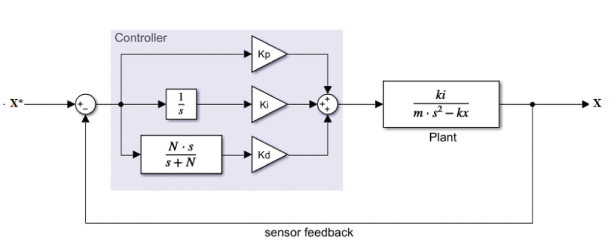
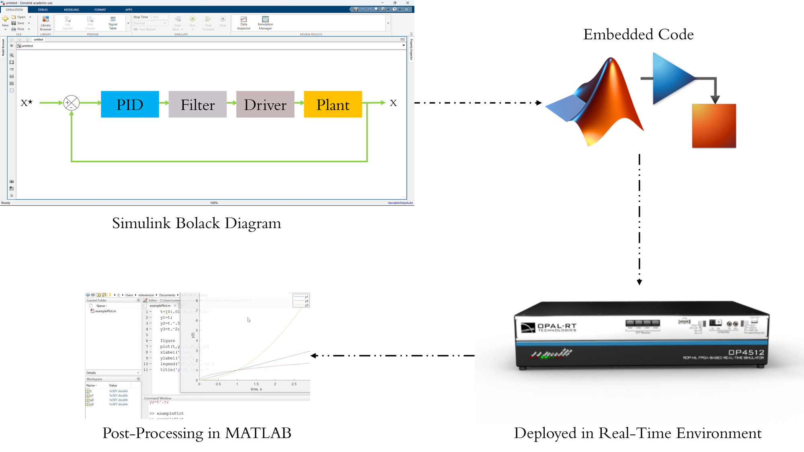
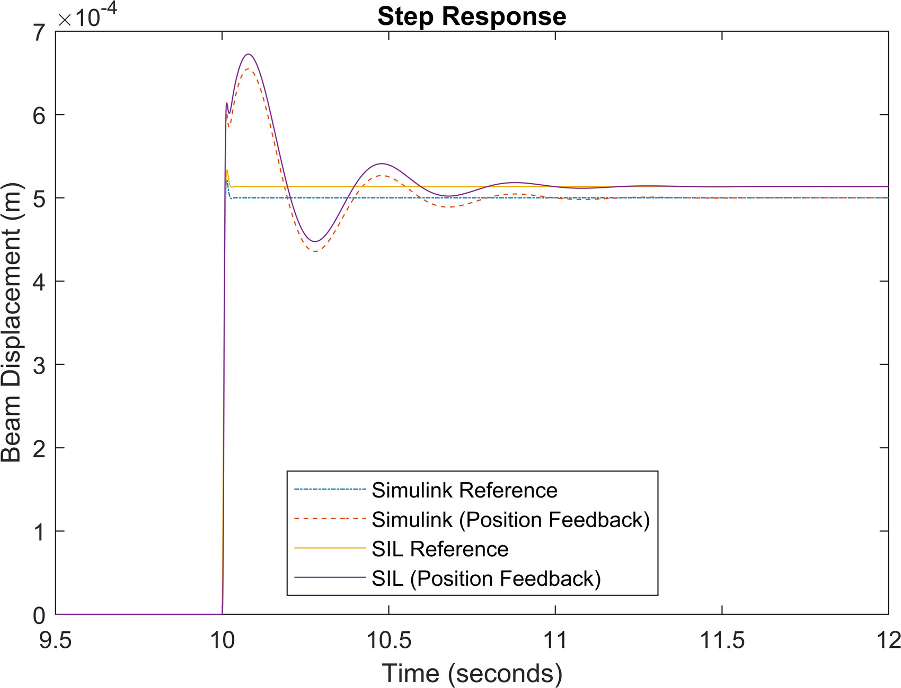
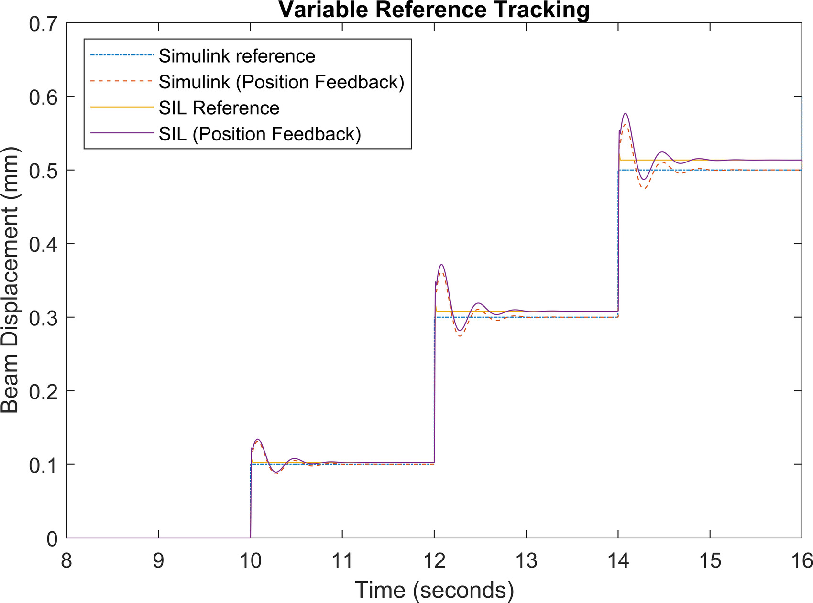
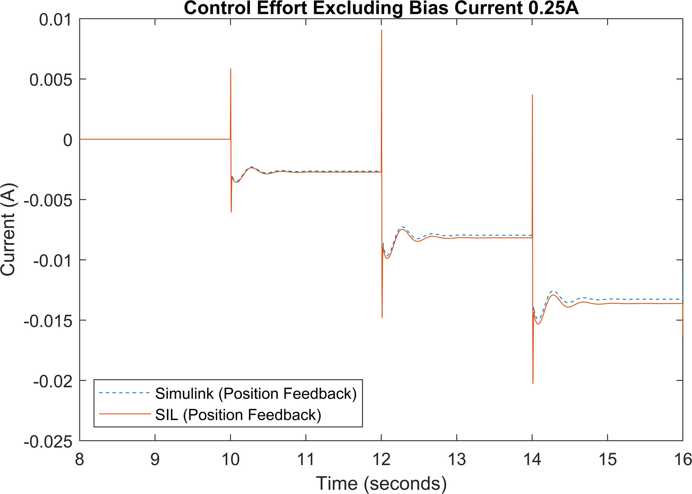

::: {.project-meta}
::: {}
**Type**<br>MSc thesis and papers
:::
::: {}
**Focus**<br>Modelling, cascaded control, real-time validation
:::
::: {}
**Tools**<br>COMSOL, MATLAB/Simulink, OPAL-RT
:::
::: {}
**Status**<br>Thesis completed Dec 2025
:::
:::

::: {.proj-hero}

:::

## Overview

Magnetic levitation holds an object in the air with no contact, which removes friction and wear. It is used in bearings, pumps, vibration isolation and transport. The same physics makes it hard to control: the force between an electromagnet and the object grows sharply as the gap closes, so the open-loop system is unstable and the force depends nonlinearly on both current and position.

In this system an electromagnet suspends a ferromagnetic beam. A sensor measures the beam position and passes it to a microcontroller, which sets the coil current through a power amplifier and closes the feedback loop. The beam can also be held between a top and a bottom electromagnet. Opposing forces about the nominal position make the response more linear and more sensitive, and the bottom magnet works as an active suspension against downward deviations.

::: {.fig-grid .two}
::: {.fig}

:::
::: {.fig}

:::
:::

## Objectives

::: {.objectives}
- Model the electromagnetic actuator and the open-loop unstable levitation dynamics.
- Design a PID position controller with a filtered derivative and a lead compensator.
- Check the controller under fixed-step real-time execution with a software-in-the-loop test on an OPAL-RT simulator.
- Run the controller on the physical levitation system for reference tracking and disturbance rejection.
:::

## Electromagnetic analysis

A three-dimensional COMSOL model of the electromagnet and the beam was used to look at the magnetic flux density and the mechanical stress in the beam as the coil current changes. The animation shows both fields over a sweep of the coil current, starting from zero current.

::: {.fig-grid .two}
::: {.fig}

:::
::: {.fig}

:::
:::

A step-by-step COMSOL tutorial covers the same model, from designing the electromagnet and defining the coil and beam properties to animating the beam displacement and sweeping the coil current and number of turns.

```{=html}
<figure class="vid solo"><div class="vid-frame"><iframe src="https://www.youtube-nocookie.com/embed/mWxRo9_m05A" title="Simulating a Magnetic Levitation System in COMSOL Multiphysics" loading="lazy" allow="accelerometer; clipboard-write; encrypted-media; gyroscope; picture-in-picture; web-share" allowfullscreen></iframe></div><figcaption>COMSOL tutorial for the levitation model · <a href="https://www.youtube.com/watch?v=mWxRo9_m05A">Watch on YouTube</a></figcaption></figure>
```

## Mathematical model

The actuator is modelled as a single air-gap magnetic circuit. For $N_t$ coil turns, effective area $A$ and nominal gap $g_0$, the inductance depends on the beam displacement $x$ as

$$L(x) = \frac{N_t^2 \mu_0 A}{g_0 - x}, \qquad F(i,x) = i^2\frac{dL}{dx} = \frac{N_t^2\mu_0 A}{(g_0 - x)^2}\, i^2 .$$

The beam is held at the mid-position $x = 0$ by a bias current $I_b$, and the current is split into $i = I_b + i_c$ with $i_c$ the control current. Linearising the force about this operating point gives a force–current coefficient and a force–displacement coefficient,

$$K_i = \frac{L_0 I_b}{g_0}, \qquad K_x = \frac{L_0 I_b^2}{g_0^2}, \qquad L_0 = \frac{N_t^2\mu_0 A}{g_0},$$

so that $m\ddot{x} = K_x x + K_i i_c$. The open-loop transfer function from control current to position is

$$\frac{X(s)}{I_c(s)} = \frac{K_i}{m s^2 - K_x}.$$

The positive $K_x$ term puts a pole in the right half-plane, which is the open-loop instability.

## Controller design

The position error is processed by a PID controller with a filtered derivative and a lead compensator, and the result drives the PWM current driver and the plant. The diagram below shows the PID structure, with proportional, integral and filtered-derivative paths acting on the error, followed by the plant.

::: {.fig-grid}
::: {.fig .wide}

:::
:::

## Real-time software-in-the-loop validation

A controller tested only in desktop Simulink runs under a variable-step solver, so sampling jitter, computation delay and fixed-step timing never show up. The software-in-the-loop (SIL) workflow closes that gap. The Simulink controller is converted to C code with MATLAB Embedded Coder and deployed on an OPAL-RT real-time simulator, where it runs with fixed, deterministic timing. Key signals are logged and post-processed in MATLAB, and the results are compared with the pure Simulink simulation.

::: {.fig-grid}
::: {.fig .wide}

:::
:::

## Results: simulation and software-in-the-loop

::: {.evidence-note}
**Data source** The quantitative results in this section compare the desktop Simulink simulation with software-in-the-loop execution on the OPAL-RT simulator. Runs on the physical system are shown under [Experimental validation](#experimental-validation).
:::

### Step response

The SIL step response follows the Simulink response very closely. Rise time, settling time and overshoot agree to within a fraction of a percent, and the peak value differs by under 3%.

<div class="table-wrap"><table class="data-table">
<thead><tr><th>Metric</th><th>Simulink only</th><th>Software-in-the-loop</th></tr></thead>
<tbody>
<tr><td>Rise time (s)</td><td>0.0049</td><td>0.0050</td></tr>
<tr><td>Settling time (s)</td><td>10.7077</td><td>10.7078</td></tr>
<tr><td>Overshoot (%)</td><td>30.96</td><td>30.96</td></tr>
<tr><td>Peak value (mm)</td><td>0.6548</td><td>0.6725</td></tr>
<tr><td>Peak time (s)</td><td>10.0785</td><td>10.0786</td></tr>
</tbody></table></div>

::: {.fig-grid}
::: {.fig .narrow}

:::
:::

### Variable reference tracking

For a sequence of reference steps the two position responses overlap, so transient behaviour, settling and tracking accuracy are preserved under real-time execution. The control effort is almost identical, with small differences at the peaks from fixed-step scheduling.

::: {.fig-grid .two}
::: {.fig}

:::
::: {.fig}

:::
:::

### Disturbance rejection

A chirp current disturbance was applied from 10 s to 90 s, sweeping from 0.1 Hz to 100 Hz. In both the low-frequency and the high-frequency time windows the Simulink and SIL displacement responses overlap closely. The controller attenuates low-frequency disturbances while keeping the reference, and it keeps suppressing high-frequency disturbances without a loss of performance, in simulation and in real-time execution alike.

## Experimental validation

::: {.evidence-note}
**Data source** Recordings of the physical levitation system.
:::

The controller was also run on the physical levitation system.

The three recordings show the progression from the initial controller to the fine-tuned one, and finally tracking combined with a disturbance.

```{=html}
<div class="vid-grid">
<figure class="vid"><div class="vid-frame"><iframe src="https://www.youtube-nocookie.com/embed/pu42liYaVK8" title="Maglev: initial controller before fine-tuning" loading="lazy" allow="accelerometer; clipboard-write; encrypted-media; gyroscope; picture-in-picture; web-share" allowfullscreen></iframe></div><figcaption>Initial controller, before fine-tuning · <a href="https://www.youtube.com/watch?v=pu42liYaVK8">Watch on YouTube</a></figcaption></figure>
<figure class="vid"><div class="vid-frame"><iframe src="https://www.youtube-nocookie.com/embed/1w6aUdawjOQ" title="Maglev: precision variable reference tracking after fine-tuning" loading="lazy" allow="accelerometer; clipboard-write; encrypted-media; gyroscope; picture-in-picture; web-share" allowfullscreen></iframe></div><figcaption>Precision tracking after fine-tuning · <a href="https://www.youtube.com/watch?v=1w6aUdawjOQ">Watch on YouTube</a></figcaption></figure>
<figure class="vid"><div class="vid-frame"><iframe src="https://www.youtube-nocookie.com/embed/IBsde6rvYdM" title="Reference Tracking and Disturbance Rejection of Maglev System" loading="lazy" allow="accelerometer; clipboard-write; encrypted-media; gyroscope; picture-in-picture; web-share" allowfullscreen></iframe></div><figcaption>Tracking with disturbance rejection · <a href="https://www.youtube.com/watch?v=IBsde6rvYdM">Watch on YouTube</a></figcaption></figure>
</div>
```

## Publications and resources

::: {.paper-card}
**Real-Time Software-in-the-loop Simulation of a Magnetic Levitation System**<br>Nehal & Ahmad (2026), IEEE SSD · [Link](https://doi.org/10.1109/SSD69655.2026.11559009)
:::

::: {.paper-card}
**Advanced sensing technologies for active magnetic bearing systems: Trends and prospects**<br>Nehal et al. (2025), Measurement · [Link](https://doi.org/10.1016/j.measurement.2025.118515)
:::

::: {.paper-card}
**Advancements in Optimization Techniques for Active Magnetic Bearing Systems**<br>Nehal et al. (2025), IEEE Access · [Link](https://doi.org/10.1109/ACCESS.2025.3575250)
:::

::: {.paper-card}
**Design, Development and Cascaded Control of Magnetic Levitation System with Differential Electromagnetic Actuators**<br>Nehal (2025), MSc thesis, King Fahd University of Petroleum and Minerals · [Link](https://doi.org/10.13140/RG.2.2.19333.51687)
:::

::: {.proj-nav}
[← All Research Projects](../index.qmd){.btn .btn-outline-primary .btn-sm}

::: {.related}
**Related projects** [Real-Time Rotor Dynamics](../realtime/index.qmd) · [Smart Materials (MR Fluid)](../mr/index.qmd) · [Data-Driven Adaptive Depth Control of an Underwater Vehicle](../datadriven/index.qmd) · [Soft Pneumatic Gripper](../soft-robotics/index.qmd)
:::
:::
