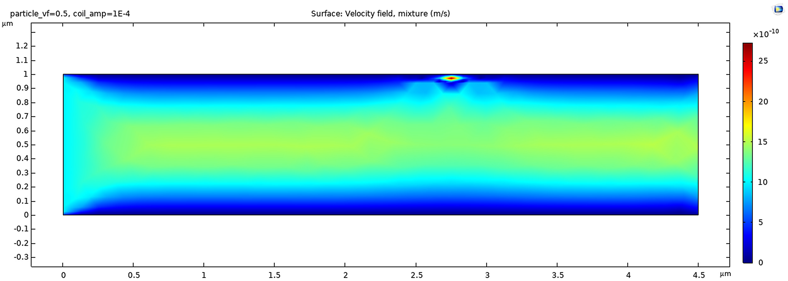
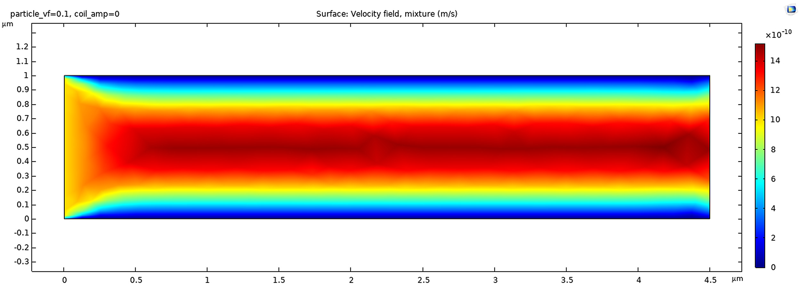
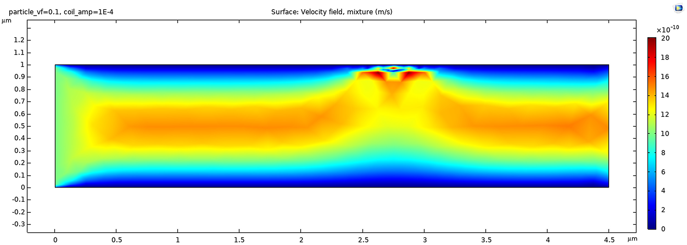
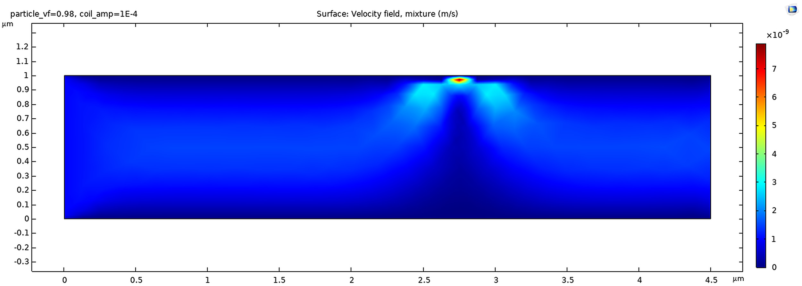
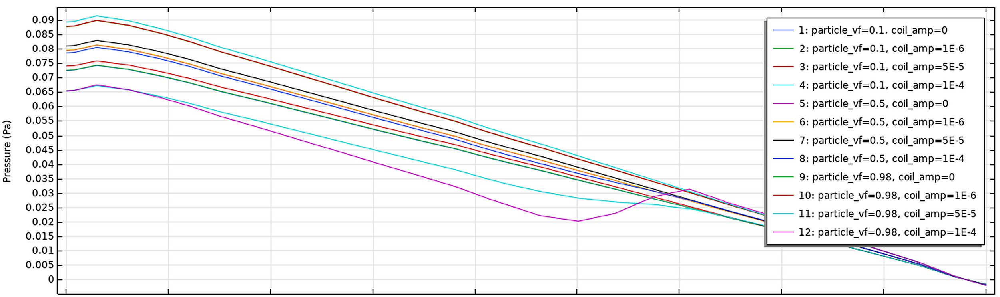
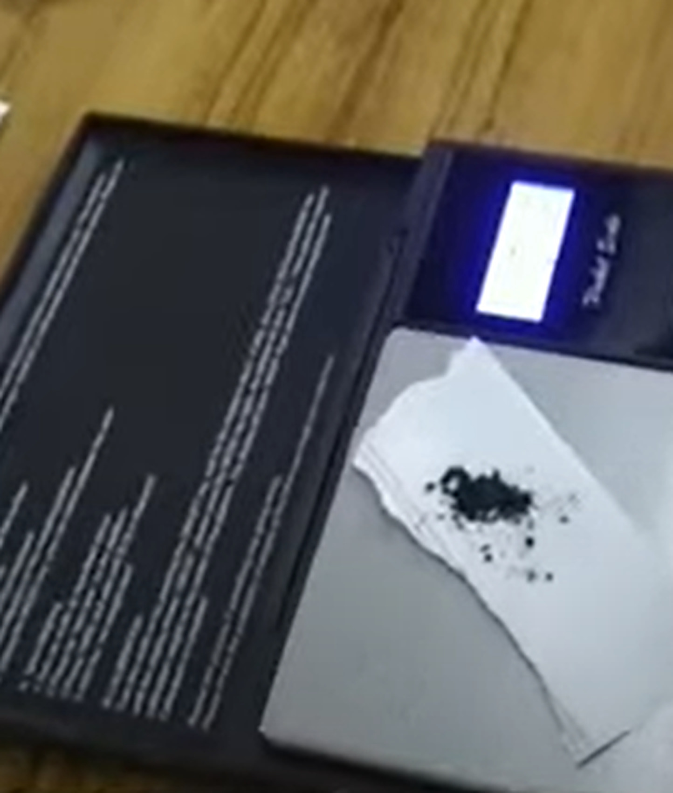
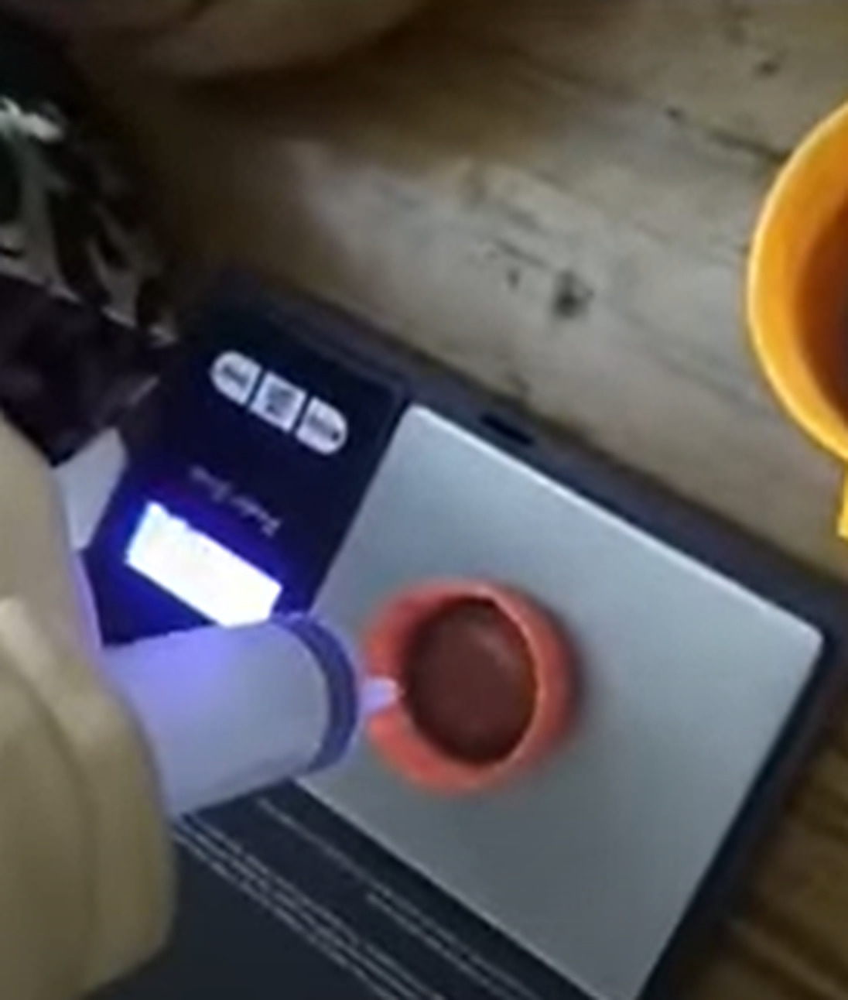
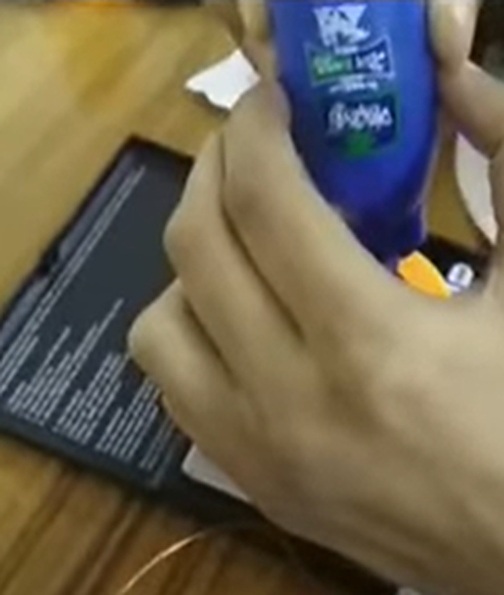
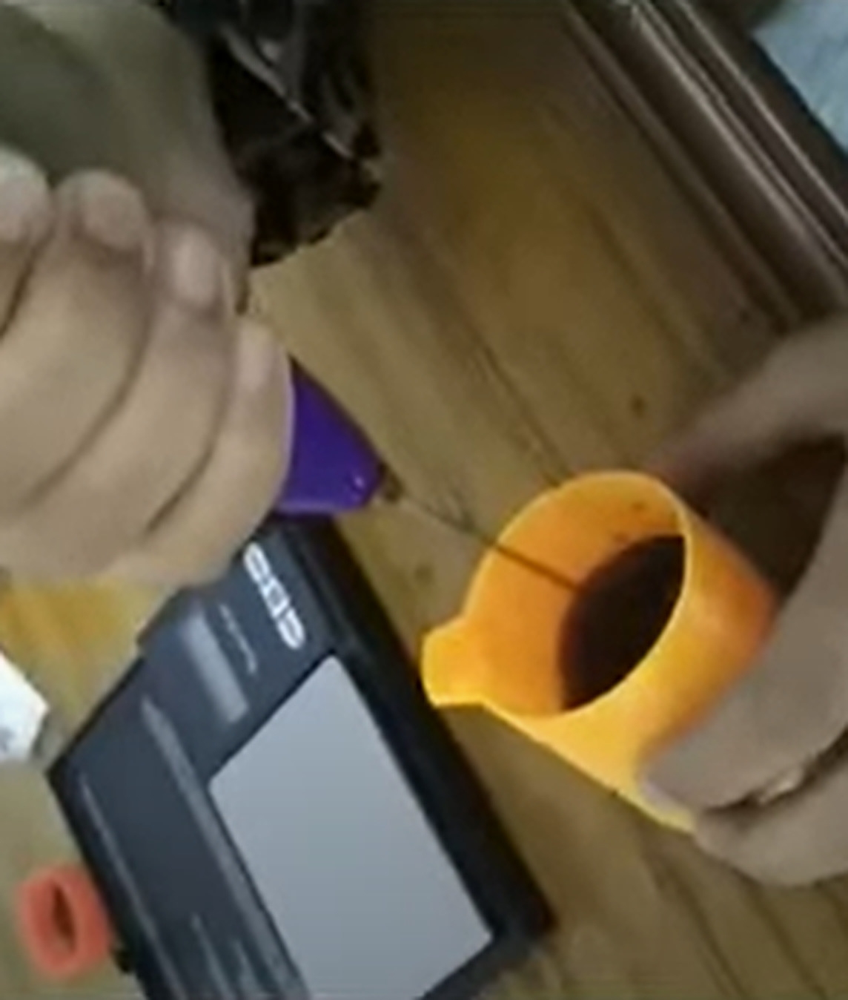
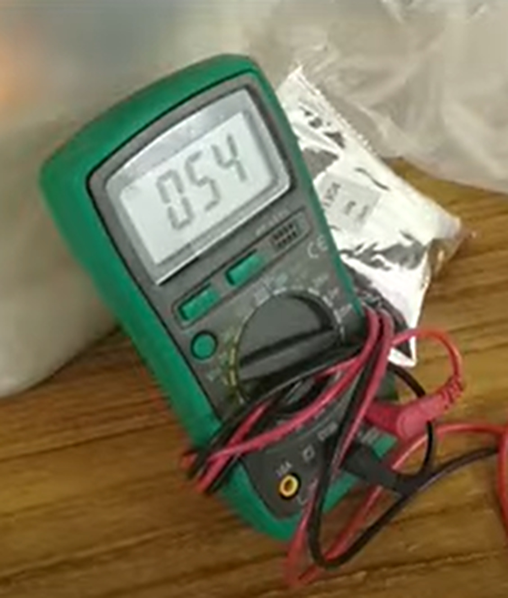

::: {.project-meta}
::: {}
**Type**<br>Simulation + lab experiment
:::
::: {}
**Material**<br>Magnetorheological (MR) fluid
:::
::: {}
**Simulation**<br>COMSOL Multiphysics
:::
::: {}
**Samples**<br>10 µm iron particles in three carriers
:::
:::

::: {.proj-hero}

:::

## Overview

A magnetorheological fluid is a liquid that stiffens in a magnetic field. It is made of tiny magnetic particles suspended in a carrier liquid, usually oil. With no field, the particles drift freely and the fluid flows like any liquid. Switch a field on and the particles line up into chains along the field lines, so the fluid turns thick or even semi-solid. Switch it off and it flows again, and the change is fast and reversible. That behavior is useful for shock absorbers, vibration dampers, prosthetics, clutches and smart braking systems.

This project has two parts: a simulation of how an MR fluid flows through a channel, and a set of bench experiments with fluids mixed by hand.

## Objectives

::: {.objectives}
- Simulate how particle volume fraction and coil current change the flow of an MR fluid in a channel.
- Test whether hand-mixed MR fluids conduct electricity with no magnetic field applied.
:::

## Part 1 · COMSOL simulation

A custom MR fluid model was built in COMSOL Multiphysics. It couples three physics interfaces and replaces the standard viscosity with a purpose-built equation, so the fluid thickens as the magnetic field and particle loading change.

::: {.steps}
::: {.step}
**Magnetic Fields (mf)**<br>Field produced by the coil
:::
::: {.step}
**Laminar Flow**<br>Flow of the carrier fluid
:::
::: {.step}
**Particle in fluid**<br>Magnetic particles carried by the flow
:::
::: {.step}
**Custom viscosity**<br>Purpose-built equation, set in the fluid viscosity model
:::
:::

The viscosity equation came from two sources: a parametric sweep that analyzes how the magnetic particles interact with each other, and a review of the literature.

<!-- TODO (Nehal): add the viscosity equation, its symbols and the literature references. -->

The test geometry is a narrow channel (about 4.5 µm long and 1 µm tall) with a coil near the top wall. A parametric sweep varied two variables:

| Variable | Values swept |
|---|---|
| Particle volume fraction | 0.1, 0.5, 0.98 |
| Coil current (field strength) | 0, 1×10⁻⁶, 5×10⁻⁵, 1×10⁻⁴ A |

That gives 12 cases. For each one the model reports the mixture velocity field and the pressure along the channel.

### Velocity field

::: {.fig-grid .two}
::: {.fig}

:::
::: {.fig}

:::
::: {.fig}

:::
::: {.fig}

:::
:::

Each panel has its own color scale, so compare the scale numbers, not just the colors.

- **No field:** the flow is smooth, fastest along the centerline and slowest near the walls.
- **Field on, 10% particles:** the field disturbs the flow around the coil, and the fast core flattens out.
- **50% particles:** the whole channel moves more slowly, and a small fast spot appears at the wall near the coil.
- **98% particles:** the channel is almost stagnant. Only a tiny region at the coil keeps moving.

### Pressure along the channel

::: {.fig-grid}
::: {.fig .wide}

:::
:::

Pressure falls from the inlet end toward zero at the outlet end in every case. The 12 curves are spread out most at the inlet end and come together toward the outlet end. One case departs from the rest, with a dip and recovery partway along the channel.

<!-- TODO (Nehal): confirm which case has the highest and lowest pressure, and add the physical explanation (viscosity / yield stress from particle chains). -->

## Part 2 · Bench experiment: homemade MR fluids

**Question:** can an MR fluid conduct electricity when there is no magnetic field?

Iron particles (10 µm) were mixed into three different carrier liquids (distilled water, coconut oil and mustard oil), probes were pushed into each mixture, and each sample was checked for signs of conduction.

::: {.fig-grid}
::: {.fig}

:::
::: {.fig}

:::
::: {.fig}

:::
::: {.fig}

:::
::: {.fig}

:::
:::

In every sample, with all three carrier liquids, the probes detected no electrical conduction without an external magnetic field. The experiment was recorded on 3 February 2023.

```{=html}
<figure class="vid solo"><div class="vid-frame"><iframe src="https://www.youtube-nocookie.com/embed/txuDdpguW-Q" title="Does MR Fluid Conduct Electricity? Experiment Results and Analysis" loading="lazy" allow="accelerometer; clipboard-write; encrypted-media; gyroscope; picture-in-picture; web-share" allowfullscreen></iframe></div><figcaption>Conductivity test of the MR fluid samples · <a href="https://www.youtube.com/watch?v=txuDdpguW-Q">Watch on YouTube</a></figcaption></figure>
```

<!-- TODO (Nehal): add the mixing ratios. -->

## Publications and resources

::: {.paper-card}
**Vibration Analysis of a Soft Hydrodynamic Manipulator**<br>Maliha, Nehal, Ahmed & Hasan (2026), *Dhaka University Journal of Science* · [DOI](https://doi.org/10.3329/dujs.v74i1.84350)
:::

::: {.proj-nav}
[← All Research Projects](../index.qmd){.btn .btn-outline-primary .btn-sm}

::: {.related}
**Related projects** [Magnetic Levitation System](../maglev/index.qmd) · [Data-Driven Adaptive Depth Control of an Underwater Vehicle](../datadriven/index.qmd) · [Soft Pneumatic Gripper](../soft-robotics/index.qmd)
:::
:::
