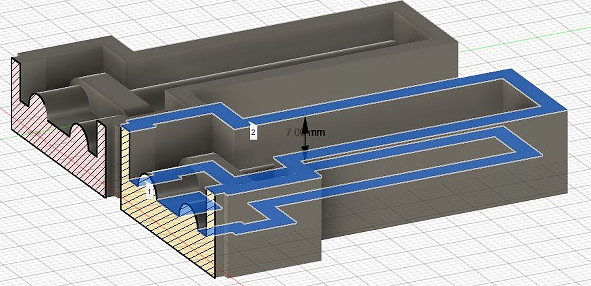
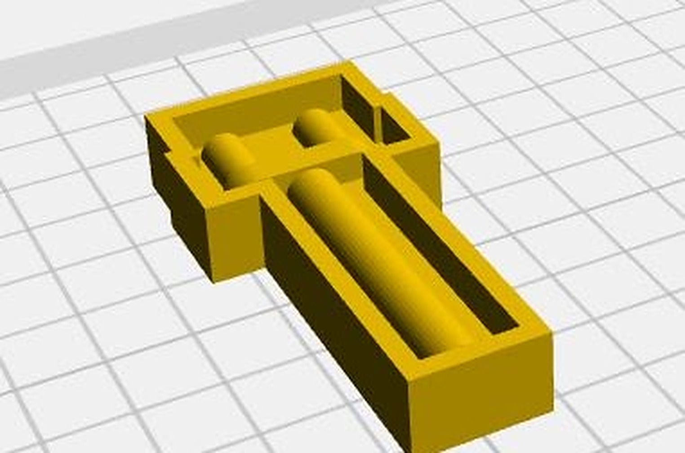
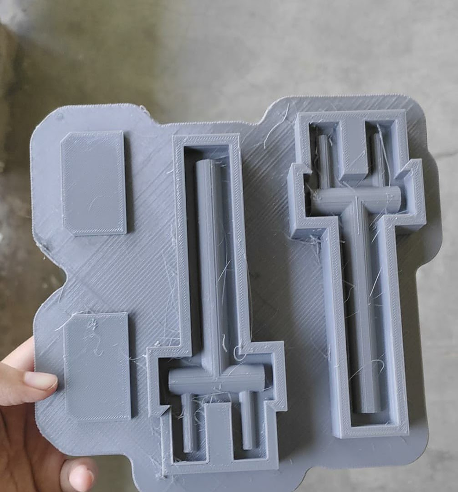
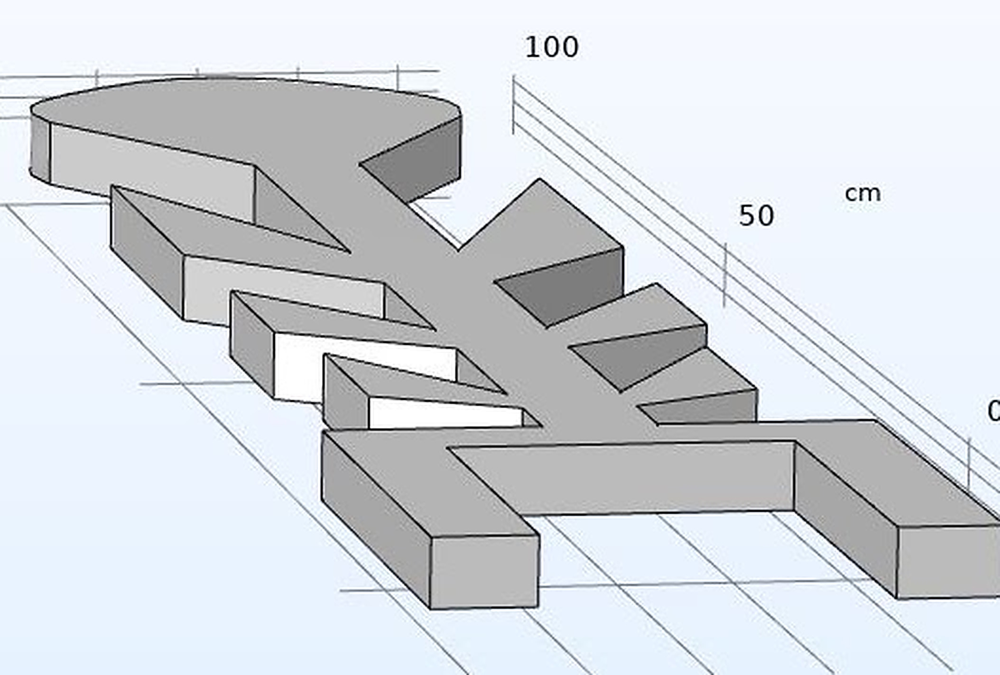
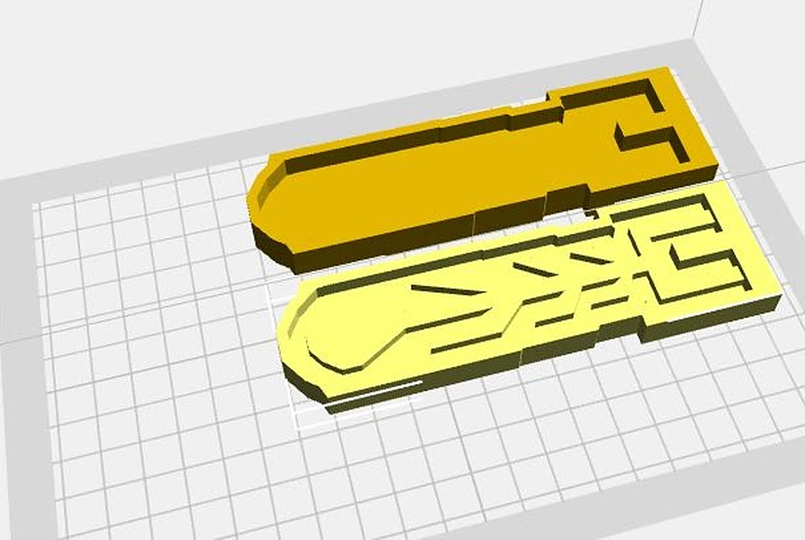
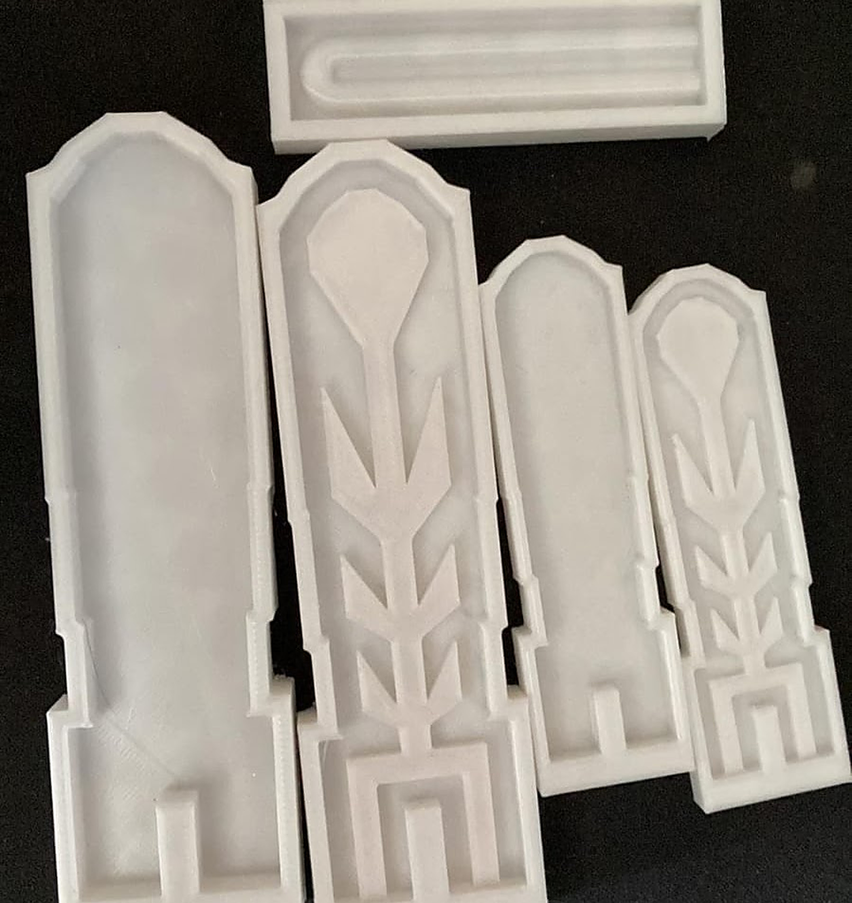
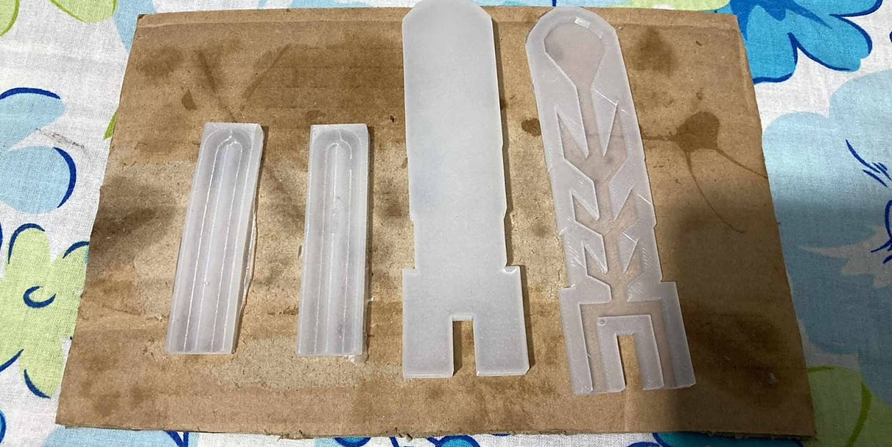

::: {.project-meta}
::: {}
**Type**<br>Lab project
:::
::: {}
**Where**<br>Robotics lab, University of Dhaka
:::
::: {}
**Material**<br>Ecoflex-0050 silicone
:::
::: {}
**Actuation**<br>Pneumatic
:::
::: {}
**Status**<br>Two prototypes built
:::
:::

## Overview

Industrial grippers lean on rigid joints, linkages and a control system to coordinate them. A soft gripper replaces that machinery with a body that deforms by design: push air in and the fingers curl around an object. This project builds such a gripper from silicone rubber. Because the body is a single soft material, it can be simpler to control, and it can be recycled, which makes it friendlier to the environment.

## Objectives

::: {.objectives}
- Build a silicone gripper whose fingers bend under air pressure.
- Replace rigid joints and linkages with a single soft, recyclable body that is simpler to control.
- Planned next step: test similar actuation with an intelligent fluid.
:::

## Design and fabrication

Each prototype followed the same loop: model the gripper in CAD, 3D-print the molds, and prepare the soft parts from Ecoflex-0050 silicone. The second prototype refines the first.

::: {.steps}
::: {.step}
**1 · Design**<br>CAD model of the gripper and its molds
:::
::: {.step}
**2 · Print**<br>3D-printed molds
:::
::: {.step}
**3 · Soft material**<br>Ecoflex-0050 silicone parts
:::
::: {.step}
**4 · Actuate**<br>Driven by air pressure
:::
::: {.step .next}
**Next · Smart fluid**<br>Test similar actuation with an intelligent fluid
:::
:::

### Prototype 1

::: {.fig-grid}
::: {.fig}

:::
::: {.fig}

:::
::: {.fig}

:::
:::

### Prototype 2

::: {.fig-grid}
::: {.fig}

:::
::: {.fig}

:::
::: {.fig}

:::
::: {.fig .wide}

:::
:::

## Demonstration

```{=html}
<figure class="vid solo"><div class="vid-frame"><iframe src="https://www.youtube-nocookie.com/embed/hw4R2CQVwpw" title="Soft pneumatic gripper demonstration" loading="lazy" allow="accelerometer; clipboard-write; encrypted-media; gyroscope; picture-in-picture; web-share" allowfullscreen></iframe></div><figcaption>Gripper demonstration · <a href="https://www.youtube.com/watch?v=hw4R2CQVwpw">Watch on YouTube</a></figcaption></figure>
```

## Publications and resources

A related paper on the vibration behavior of a soft manipulator, published in 2026.

::: {.paper-card}
**Vibration Analysis of a Soft Hydrodynamic Manipulator**<br>Maliha, Nehal, Ahmed & Hasan (2026), *Dhaka University Journal of Science* · [DOI](https://doi.org/10.3329/dujs.v74i1.84350)
:::

<!-- TODO (Nehal): add quantitative results when available: bend angle vs pressure, grip force, cycle life. -->

::: {.proj-nav}
[← All Research Projects](../index.qmd){.btn .btn-outline-primary .btn-sm}

::: {.related}
**Related projects** [Magnetic Levitation System](../maglev/index.qmd) · [Smart Materials (MR Fluid)](../mr/index.qmd) · [Data-Driven Adaptive Depth Control of an Underwater Vehicle](../datadriven/index.qmd)
:::
:::
