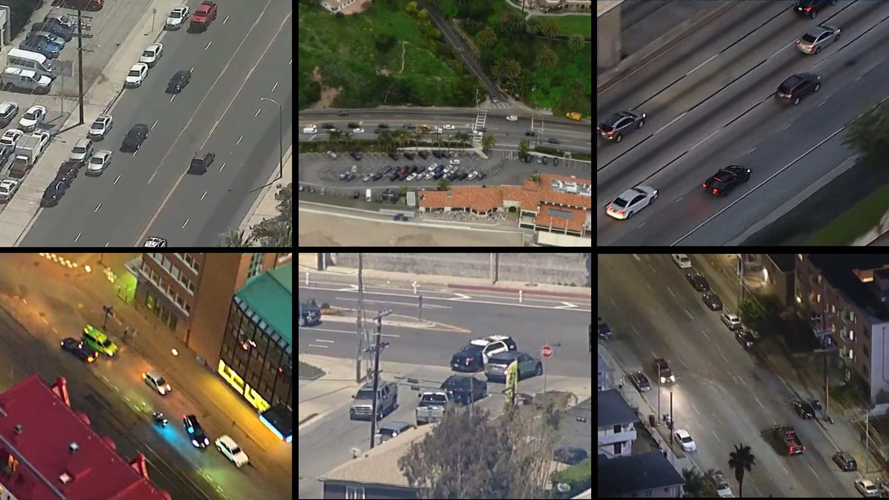
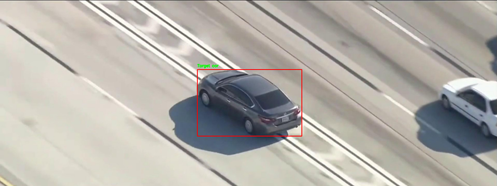
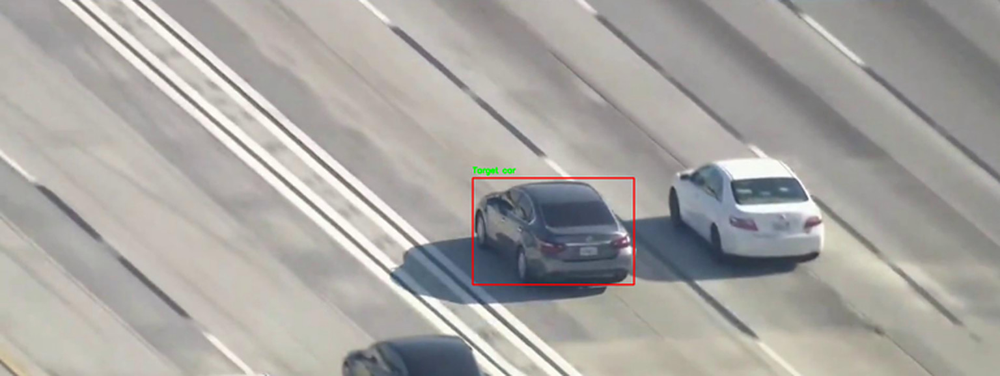
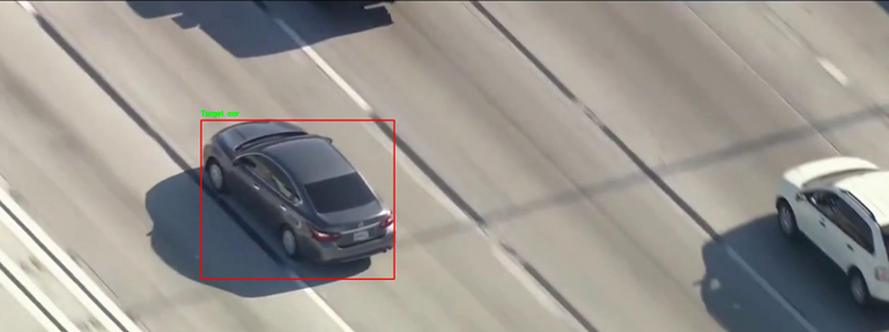
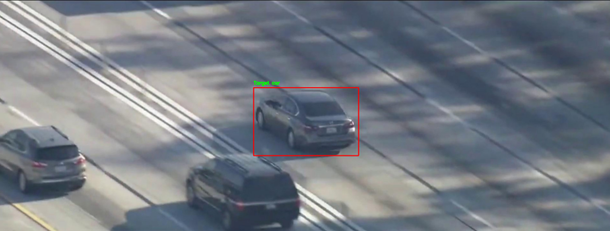
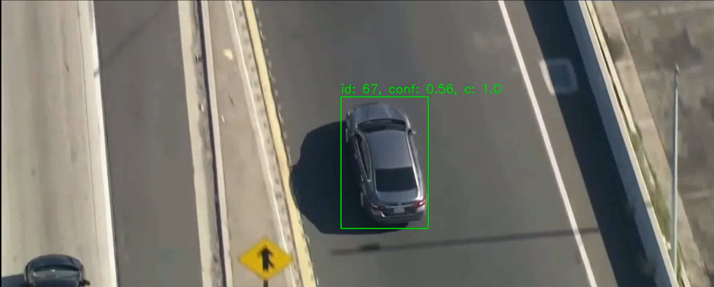
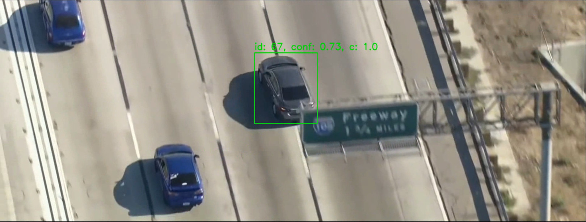
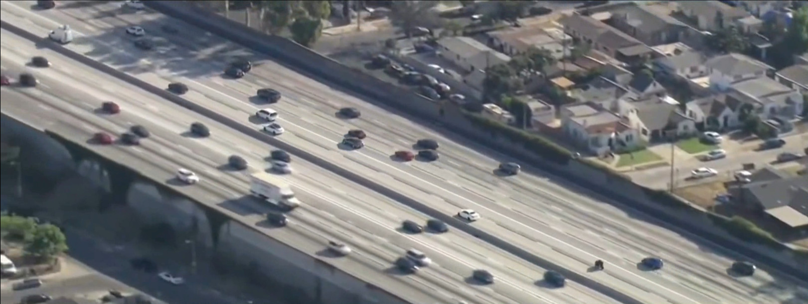
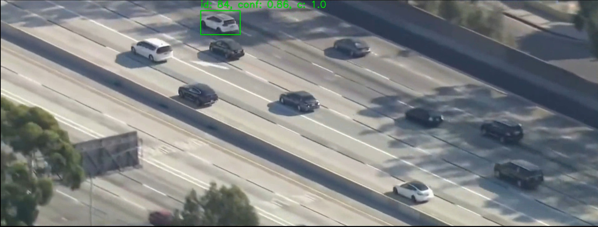
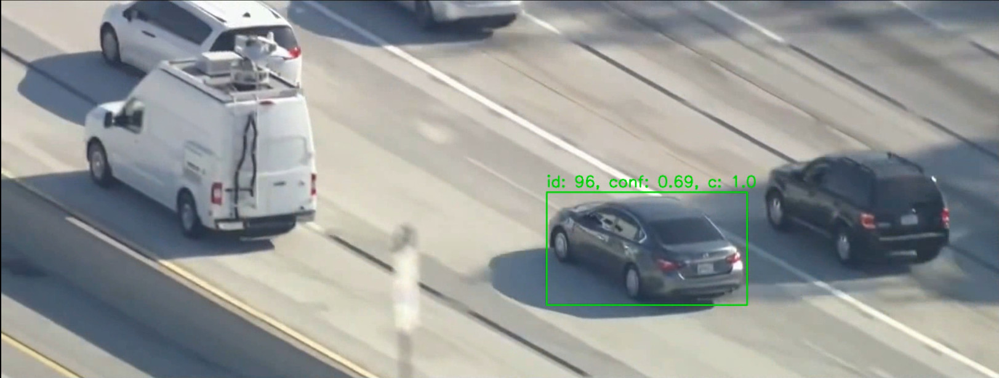

::: {.project-meta}
::: {}
**Type**<br>Course project
:::
::: {}
**Focus**<br>UAV detection and tracking
:::
:::

::: {.proj-hero}

:::

## Overview

Helicopter and drone footage of police chases is a hard test for computer vision. The camera moves, the viewing angle changes, the target is small and often shares the road with similar cars, and it can disappear behind bridges and trucks. This project builds and evaluates a pipeline that follows one chosen vehicle through such footage, from a single bounding box given in the first frame.

The pipeline detects every vehicle in each frame, describes the chosen target with appearance features, and keeps its identity from frame to frame with a re-identification tracker. The work covers dataset preparation, a benchmark of four detectors, a comparison of four trackers and a statistical ranking of every detector and tracker combination.

## Objectives

::: {.objectives}
- Follow one chosen vehicle through aerial chase footage from a single first-frame bounding box.
- Prepare a detection dataset from chase footage and benchmark four detectors.
- Compare four trackers and rank every detector and tracker combination statistically.
:::

## Demonstration

```{=html}
<figure class="vid solo"><div class="vid-frame"><iframe src="https://www.youtube-nocookie.com/embed/Y6vnomnUfNQ" title="UAV-based Vehicle Detection And Tracking: High-Speed Police Chase" loading="lazy" allow="accelerometer; clipboard-write; encrypted-media; gyroscope; picture-in-picture; web-share" allowfullscreen></iframe></div><figcaption>Tracking demonstration · <a href="https://www.youtube.com/watch?v=Y6vnomnUfNQ">Watch on YouTube</a></figcaption></figure>
```

## Pipeline

::: {.steps}
::: {.step}
**1. Read frames**<br>Video frames read with OpenCV
:::
::: {.step}
**2. Detect**<br>YOLO or Detectron2 models return boxes, classes and confidence
:::
::: {.step}
**3. Target template**<br>The first-frame box is cropped as the reference
:::
::: {.step}
**4. Match**<br>CNN features with cosine similarity, plus SIFT keypoints
:::
::: {.step}
**5. Filter**<br>Keep boxes above the similarity threshold
:::
::: {.step}
**6. Track**<br>The tracker keeps the target identity across frames
:::
:::

### Finding the target in each frame

The target is cropped from the first frame and every detected box is cropped and resized to a fixed input size, so that boxes of different sizes can be compared. A convolutional network turns each crop into a feature vector. Boxes whose cosine similarity to the target is above a threshold (for example 0.9) stay as candidates.

Local structure is checked as well. SIFT keypoints are matched between the target crop and each candidate, and the candidate with the most matches wins. If several boxes tie, the one with the higher cosine similarity is chosen. Using global appearance together with local keypoints makes the match more robust than either alone.

## Dataset preparation

A detector was first trained on the UAVDT aerial benchmark and then fine-tuned in four steps on frames taken from the chase videos. Each step changed the vehicle classes, the amount of manual correction or the augmentation, and the validation results were recorded after each one.

<div class="table-wrap"><table class="data-table wrap">
<thead><tr><th>Stage</th><th>Image source</th><th>Annotations</th><th>Train / val images</th><th>Precision</th><th>Recall</th><th>mAP50</th><th>mAP50-95</th></tr></thead>
<tbody>
<tr><td>Dataset 0</td><td>UAVDT benchmark</td><td>bus, car, truck</td><td>28,507 / 8,145</td><td>0.974</td><td>0.972</td><td>0.990</td><td>0.849</td></tr>
<tr><td>Dataset 1</td><td>36 frames from the first chase video</td><td>suv, car, truck (bus removed)</td><td>34 / 17</td><td>0.920</td><td>0.947</td><td>0.981</td><td>0.936</td></tr>
<tr><td>Dataset 2</td><td>211 frames from 13 chase videos</td><td>Mislabels corrected by hand, augmented 200×</td><td>17,975 / 4,495</td><td>0.947</td><td>0.929</td><td>0.976</td><td>0.886</td></tr>
<tr><td>Dataset 3</td><td>8,522 frames from 13 chase videos</td><td>No manual correction, augmented 5×</td><td>21,384 / 5,347</td><td>0.922</td><td>0.880</td><td>0.948</td><td>0.886</td></tr>
<tr><td>Dataset 4</td><td>12,773 frames from 13 chase videos</td><td>No manual correction, augmented 3×</td><td>20,299 / 5,074</td><td>0.938</td><td>0.915</td><td>0.969</td><td>0.907</td></tr>
</tbody></table></div>

Augmentation used horizontal flips, 90° rotations, small shift, scale and rotation changes, brightness and contrast jitter, hue, saturation and RGB shifts, and random cut-out patches.

## Detector benchmark

Four detectors were compared: Faster R-CNN, RetinaNet, Cascade R-CNN and YOLO. Each was run at four confidence thresholds (0.5, 0.3, 0.1 and 1e-5) on a test video of 975 frames at 15 FPS in which only the target vehicle was annotated by hand.

Two measures were used. A target counts as **found** when a predicted box overlaps the ground truth with an IoU above 0.8. Its class counts as **identified** when the correct class appears among the predicted boxes. A **multiclass error** adds up the extra, incorrect boxes predicted when the class is right, so it shows how noisy the detector is around the target.

::: {.fig-grid .two}
::: {.fig}

:::
::: {.fig}

:::
::: {.fig}

:::
::: {.fig}

:::
:::

### Best configuration per detector

Target-found accuracy at the lowest threshold, with the average time per frame:

<div class="bars">
<div class="bar-row"><span class="bar-label">Cascade R-CNN</span><span class="bar-track"><span class="bar-fill" style="width:91.9%"></span></span><span class="bar-val">0.919 · 1.87 s</span></div>
<div class="bar-row"><span class="bar-label">Faster R-CNN</span><span class="bar-track"><span class="bar-fill" style="width:91.6%"></span></span><span class="bar-val">0.916 · 1.22 s</span></div>
<div class="bar-row"><span class="bar-label">RetinaNet</span><span class="bar-track"><span class="bar-fill" style="width:88.2%"></span></span><span class="bar-val">0.882 · 1.09 s</span></div>
<div class="bar-row"><span class="bar-label">YOLO</span><span class="bar-track"><span class="bar-fill" style="width:62.5%"></span></span><span class="bar-val">0.625 · 0.48 s</span></div>
</div>

Cascade R-CNN and Faster R-CNN found the target in about 92% of frames, with Faster R-CNN needing about a third less time per frame. YOLO was the fastest by a wide margin, but found the target far less often on this test video. A Friedman test over the sixteen detector and threshold combinations found no statistically significant difference between them (p = 0.9991).

<details class="more"><summary>All sixteen detector configurations</summary>
<div class="table-wrap"><table class="data-table">
<thead><tr><th>Model</th><th>Conf. threshold</th><th>Target found</th><th>Class identified</th><th>Multiclass error</th><th>Time / frame</th></tr></thead>
<tbody>
<tr><td>Faster R-CNN</td><td>0.5</td><td>0.849</td><td>0.788</td><td>0.12</td><td>1.25 s</td></tr>
<tr><td></td><td>0.3</td><td>0.887</td><td>0.884</td><td>0.20</td><td>1.24 s</td></tr>
<tr><td></td><td>0.1</td><td>0.911</td><td>0.899</td><td>0.15</td><td>1.23 s</td></tr>
<tr><td></td><td>1e-5</td><td>0.916</td><td>0.899</td><td>0.12</td><td>1.22 s</td></tr>
<tr><td>RetinaNet</td><td>0.5</td><td>0.820</td><td>0.820</td><td>0.07</td><td>1.09 s</td></tr>
<tr><td></td><td>0.3</td><td>0.860</td><td>0.858</td><td>0.34</td><td>1.09 s</td></tr>
<tr><td></td><td>0.1</td><td>0.882</td><td>0.875</td><td>0.13</td><td>1.09 s</td></tr>
<tr><td></td><td>1e-5</td><td>0.882</td><td>0.875</td><td>0.03</td><td>1.10 s</td></tr>
<tr><td>Cascade R-CNN</td><td>0.5</td><td>0.768</td><td>0.768</td><td>0.00</td><td>1.83 s</td></tr>
<tr><td></td><td>0.3</td><td>0.908</td><td>0.907</td><td>0.25</td><td>1.87 s</td></tr>
<tr><td></td><td>0.1</td><td>0.917</td><td>0.916</td><td>0.19</td><td>1.87 s</td></tr>
<tr><td></td><td>1e-5</td><td>0.919</td><td>0.916</td><td>0.18</td><td>1.87 s</td></tr>
<tr><td>YOLO</td><td>0.5</td><td>0.430</td><td>0.430</td><td>0.00</td><td>0.49 s</td></tr>
<tr><td></td><td>0.3</td><td>0.490</td><td>0.489</td><td>0.00</td><td>0.49 s</td></tr>
<tr><td></td><td>0.1</td><td>0.547</td><td>0.544</td><td>0.00</td><td>0.49 s</td></tr>
<tr><td></td><td>1e-5</td><td>0.625</td><td>0.605</td><td>0.00</td><td>0.48 s</td></tr>
</tbody></table></div>
</details>

## Tracker comparison

Four trackers were combined with each detector and threshold: DeepOCSORT, StrongSORT, BoT-SORT and ByteTrack. The first three use a pretrained re-identification network to associate detections across frames. ByteTrack relies on box overlap alone.

<div class="table-wrap"><table class="data-table">
<thead><tr><th>Parameter</th><th>DeepOCSORT</th><th>StrongSORT</th><th>BoT-SORT</th><th>ByteTrack</th></tr></thead>
<tbody>
<tr><td>Model weights</td><td>osnet_x0_25_msmt17</td><td>mobilenetv2_x1_4_dukemtmcreid</td><td>osnet_x0_25_msmt17</td><td>n/a</td></tr>
<tr><td>Detection threshold</td><td>0.1</td><td>0.1</td><td>0.1</td><td>0.1</td></tr>
<tr><td>Max age</td><td>50</td><td>50</td><td>50</td><td>50</td></tr>
<tr><td>Min hits</td><td>3</td><td>3</td><td>n/a</td><td>n/a</td></tr>
<tr><td>Tracker (IoU) threshold</td><td>0.3</td><td>0.3</td><td>0.3</td><td>0.3</td></tr>
<tr><td>Track buffer</td><td>n/a</td><td>7</td><td>50</td><td>50</td></tr>
<tr><td>Frame rate</td><td>n/a</td><td>n/a</td><td>15</td><td>15</td></tr>
</tbody></table></div>

Tracking was scored against the hand-annotated ground truth with the MOT metrics HOTA (area under the curve), MOTP, CLR true and false positives, ID switches, IDF1, ID recall and ID precision. HOTA balances detection and association accuracy. ID switches count how often the target is given a new identity, so lower is better.

### Ranking

A Friedman test across all combinations rejected the hypothesis that the trackers perform equally (statistic 10.98, p ≈ 0). The ground truth acts as a perfect tracker and ranks first. Average rank, lower is better:

<div class="bars">
<div class="bar-row"><span class="bar-label wide">Ground truth (perfect tracker)</span><span class="bar-track"><span class="bar-fill alt" style="width:100.0%"></span></span><span class="bar-val">1</span></div>
<div class="bar-row"><span class="bar-label wide">DeepOCSORT + YOLO @ 0.3</span><span class="bar-track"><span class="bar-fill alt" style="width:60.9%"></span></span><span class="bar-val">8.8125</span></div>
<div class="bar-row"><span class="bar-label wide">StrongSORT + YOLO @ 0.3</span><span class="bar-track"><span class="bar-fill alt" style="width:57.5%"></span></span><span class="bar-val">9.5</span></div>
<div class="bar-row"><span class="bar-label wide">DeepOCSORT + YOLO @ 0.1</span><span class="bar-track"><span class="bar-fill alt" style="width:51.9%"></span></span><span class="bar-val">10.625</span></div>
<div class="bar-row"><span class="bar-label wide">DeepOCSORT + YOLO @ 0.5</span><span class="bar-track"><span class="bar-fill alt" style="width:49.4%"></span></span><span class="bar-val">11.125</span></div>
<div class="bar-row"><span class="bar-label wide">StrongSORT + YOLO @ 0.5</span><span class="bar-track"><span class="bar-fill alt" style="width:43.8%"></span></span><span class="bar-val">12.25</span></div>
<div class="bar-row"><span class="bar-label wide">DeepOCSORT + Cascade R-CNN @ 0.3</span><span class="bar-track"><span class="bar-fill alt" style="width:43.4%"></span></span><span class="bar-val">12.3125</span></div>
<div class="bar-row"><span class="bar-label wide">StrongSORT + YOLO @ 0.1</span><span class="bar-track"><span class="bar-fill alt" style="width:39.7%"></span></span><span class="bar-val">13.0625</span></div>
<div class="bar-row"><span class="bar-label wide">ByteTrack + YOLO @ 0.1</span><span class="bar-track"><span class="bar-fill alt" style="width:35.0%"></span></span><span class="bar-val">14</span></div>
</div>

The top five combinations are all built on the YOLO detector, even though it scored lowest in the detection test. DeepOCSORT and StrongSORT, the two trackers that use re-identification features, take the leading places.

## Tracking examples

Five frames from one chase, including the cases where tracking fails. The green box carries the tracker identity, confidence and class. Small targets in dense traffic are the hardest case, and the target is picked up again once the view gets closer.

::: {.fig-grid .two}
::: {.fig}

:::
::: {.fig}

:::
::: {.fig}

:::
::: {.fig}

:::
::: {.fig .wide}

:::
:::

## Source footage

The chase footage comes from public news-channel live streams, listed below.

<details class="more"><summary>Chase videos used as source material (17)</summary>
<ol>
<li><a href="https://www.youtube.com/live/d8RbwlsB9ZE">Authorities chase large truck through the San Fernando Valley</a></li>
<li><a href="https://www.youtube.com/live/zBQQpDJNNdw">Wild high-speed chase of stolen Jaguar through LA freeways</a></li>
<li><a href="https://youtu.be/HLORcVHphpY">Dallas wrong-way chase, full chopper footage</a></li>
<li><a href="https://youtu.be/VMxjFTtTquc">Dodge Hellcat outruns chopper in Houston police chase</a></li>
<li><a href="https://www.youtube.com/live/CCjJho9hl4c">LAPD chasing murder suspect on surface streets in Los Angeles</a></li>
<li><a href="https://www.youtube.com/live/vF6N31vRCXM">LAPD chasing possible robbery suspect near South Los Angeles</a></li>
<li><a href="https://www.youtube.com/live/jTHEcujoVJA">Spike strip shreds tires on SUV, ends pursuit through San Gabriel Valley</a></li>
<li><a href="https://youtu.be/QtktaBwYfEY">Police helicopter chase</a></li>
<li><a href="https://www.youtube.com/live/Qbxh1u36xF8">Police chase kidnapping suspect near Whittier</a></li>
<li><a href="https://youtu.be/d1LXS92qKfA">Police chase stolen car, man sips beer during standoff</a></li>
<li><a href="https://www.youtube.com/live/NZlQNTfWWu4">Police chase stolen party bus across Southern California</a></li>
<li><a href="https://www.youtube.com/live/XiXpu1a2aRo">Police chase through West LA</a></li>
<li><a href="https://www.youtube.com/live/aD_47BmERvM">Police chase underway on 10 Freeway</a></li>
<li><a href="https://www.youtube.com/live/BezhURmje_E">Police chase vehicle near South LA</a></li>
<li><a href="https://www.youtube.com/live/9N5Y3WgZB-w">Authorities in pursuit of robbery suspect through Los Angeles County</a></li>
<li><a href="https://www.youtube.com/live/q4mavS3q9ZE">Dangerous pursuit ends in citizen's arrest</a></li>
<li><a href="https://www.youtube.com/live/bZt8Bzs08TM">Police chasing carjacking suspect on 91 Freeway near Corona</a></li>
</ol>
</details>

## Publications and resources

::: {.paper-card}
**UAV-Based Vehicle Detection and Tracking: High-Speed Police Chase**<br>Nehal et al. (2025), preprint · [Link](https://www.researchgate.net/publication/396170423_UAV-Based_Vehicle_Detection_and_Tracking_High-Speed_Vehicle_Chase)
:::

::: {.proj-nav}
[← All Research Projects](../index.qmd){.btn .btn-outline-primary .btn-sm}

::: {.related}
**Related projects** [Sandwich Biosensor](../biosensor/index.qmd) · [Real-Time Rotor Dynamics](../realtime/index.qmd) · [Data-Driven Adaptive Depth Control of an Underwater Vehicle](../datadriven/index.qmd) · [EV Drivetrain and Battery Pack](../fsai/index.qmd)
:::
:::
